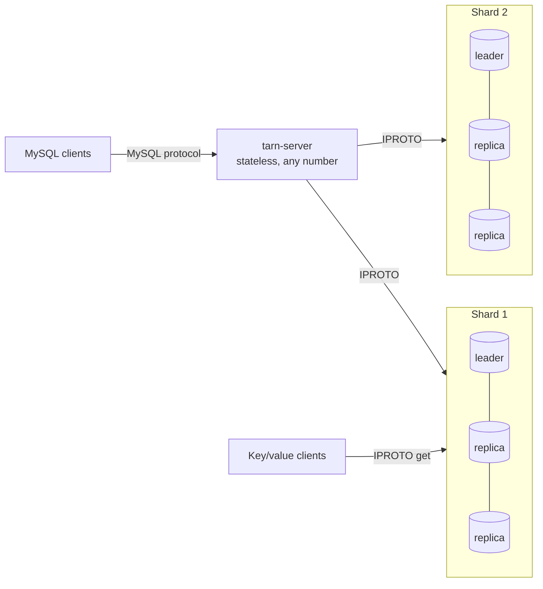

# Tarn

**A distributed MySQL-compatible SQL database on [Tarantool](https://www.tarantool.io), strictly serializable by default, with a TLA+-checked commit protocol and a Verus-verified core.**

[](https://github.com/cstheorist/tarn/actions/workflows/ci.yml)
[](#license)
[](rust-toolchain.toml)

Tarn speaks the MySQL protocol, stores every SQL table as an ordinary
sharded Tarantool space -- in RAM (memtx) or on disk (vinyl) -- and commits
transactions that span shards with **strict serializability** by default. Because rows
are plain Tarantool tuples, applications can also skip SQL entirely and
read them as **key/value**.

> **Status: research prototype (v0.1).** The commit protocol is model-checked
> and the core is tested hard, but Tarn lacks much of what production use
> needs (TLS, automatic rebalancing, much of MySQL's SQL surface). See
> [limitations](docs/design.md#6-limitations).

## Highlights

* **MySQL-compatible.** The `mysql` CLI, sysbench, PyMySQL and other MySQL
  clients connect unchanged: text and binary protocol, prepared statements,
  multi-statement batches, sysbench-level SQL plus joins, aggregates,
  subqueries and `UNION`; `mysqldump` files load as they are.
* **Co-located joins.** Primary-prefix joins over a bound shared shard key
  use one bounded, lock-checked storage request. Other equality joins batch
  their inner lookups by shard.
* **Optional lazy secondary indexes.** Non-unique keys with
  `COMMENT 'tarn:lazy'` maintain an asynchronous global copy. Eligible
  autocommit lookups read one index shard, fetch current base rows and
  recheck their predicates; they may miss recent matches. A session can
  wait for its own writes. Transactions retain the strong local index.
  See [the consistency and operational contract](docs/lazy-indexes.md).
* **Schema changes.** `ALTER TABLE` retains existing tuple layouts.
  Native index builds run online; indexed instant defaults and lazy-index
  bootstrap use bounded write fences while reads remain available.
* **Tarantool storage.** Each shard is a Tarantool replica set with
  synchronous replication and automatic leader election. Tables are hash
  sharded with vshard's bucket function and live in RAM (memtx) or, with
  `ENGINE=vinyl`, on disk; one transaction may span both. Buckets move
  between shards online (`TARN MOVE BUCKET`) while transactions use their
  rows, and shards join and leave a running cluster (`TARN ADD SHARD`,
  `TARN REMOVE SHARD`), which `TARN REBALANCE` evens out by size or by
  load.
* **Strictly serializable transactions** across shards: lock-aware reads,
  MVCC-validated single-shard commits, and a parallel-commit two-phase commit
  whose recovery survives coordinator crashes and leader failover.
* **READ COMMITTED as InnoDB does it**, per session: row locks with wait
  queues, lock wait timeouts and deadlock detection, `SKIP LOCKED` and
  `NOWAIT`, unique keys locked by value, savepoints. Hot-row updates wait
  instead of aborting, and commits stay atomic across shards.
* **Key/value fast path.** Committed rows are ordinary tuples
  (`box.space['demo.orders'].index.primary:get{42}`): about 260,000 direct
  reads per second on two vCPUs.
* **Verified where it matters.** The commit protocol is specified in TLA+
  and model-checked with TLC (153 default configurations, including 108
  broken or tradeoff cases that TLC must expose). Shard routing, commit decisions,
  the MySQL packet codec and the MessagePack of the native storage procedures are
  proven correct with [Verus](https://github.com/verus-lang/verus) and compiled
  into the server and its native module.
* **Tested against reality.** Exact differential tests against MariaDB,
  transaction-anomaly tests, a ledger-checked bank workload under leader
  failover and bucket moves, and fault injection for lost replies.

## Quick start

You need Rust (via [rustup](https://rustup.rs)), Tarantool 3.x on your
`PATH`, and a MySQL client.

```sh
git clone https://github.com/cstheorist/tarn.git && cd tarn
cargo build --release       # tarn-server, and the storage nodes' native procedures
scripts/cluster.sh start -n 2 -r 1 -p 4000      # 2 shards, SQL on port 4000
```

```sh
mysql -h 127.0.0.1 -P 4000 -u root -e "
  CREATE DATABASE demo;
  CREATE TABLE demo.orders (id BIGINT PRIMARY KEY AUTO_INCREMENT,
                            customer INT NOT NULL, total DECIMAL(10,2), KEY c (customer));
  INSERT INTO demo.orders (customer, total) VALUES (7, 19.99), (8, 5.00);
  SELECT * FROM demo.orders WHERE id = 1;"
```

The same row, read straight from Tarantool:

```lua
-- tarantool
local c = require('net.box').connect('tarn:tarn@127.0.0.1:3311')
c.space['demo.orders'].index.primary:get{1}   -- on whichever shard owns it
```

`scripts/cluster.sh start -n 2 -r 3` gives every shard three synchronous
replicas with automatic failover. The [getting started guide](docs/getting-started.md)
walks through all of this, including a failover.

## How it works



* An **autocommit point read** is one call to the owning shard. It waits
  if a committed cross-shard transaction has not yet been applied to that
  row, which is what makes even single-shard reads strictly serializable.
* An **autocommit single-row write** is one local Tarantool transaction.
* A **transaction** reads inside Tarantool streams (memtx MVCC tracks its
  reads), buffers its writes in `tarn-server`, and commits locally on one
  shard, by validation if it only read, or with a parallel-commit two-phase
  commit across shards: PREPARE takes durable locks with the new values as
  intents, the transaction is committed as soon as every participant is
  prepared, and APPLY moves the intents into the tables.

The [design document](docs/design.md) covers the protocol, recovery, record
garbage collection, and the argument for why it is correct.

## Performance

sysbench on one 2-vCPU VM, with the load generator on the same VM; best
throughput over 1, 16 and 64 threads. MariaDB and MySQL run REPEATABLE READ;
Tarn runs strict serializable.

| Workload | MariaDB 10.11 | MySQL 9.7 | Tarn, 2 shards | Tarn, 1 shard × 3 replicas |
|---|---:|---:|---:|---:|
| `oltp_point_select` (QPS) | 46,391 | 26,442 | 29,711 | 32,389 |
| `oltp_update_index` (TPS) | 28,197 | 13,237 | 17,617 | 10,231 |
| `oltp_insert` (TPS) | 30,020 | 17,493 | 16,646 | 11,566 |
| `oltp_read_write` (TPS) | 1,389 | 726 | 356 | 495 |
| direct key/value reads (ops/s) | – | – | 259,797 | – |

On single-row statements Tarn is ahead of MySQL 9.7 here and reaches 55–75%
of MariaDB at 64 threads. Multi-statement transactions reach 45–70% of
MySQL: they need 10–20 storage round trips each, and on two shards almost
every write transaction is a two-phase commit. Rankings shift with hardware:
on another host Tarn was behind MySQL on point selects. Full tables,
latencies, abort rates and a per-vCPU comparison with published TiDB and
YugabyteDB results are in [bench/RESULTS.md](bench/RESULTS.md). These runs
predate the shards' native procedures, which serve reads, autocommit
writes and the transactions of one shard without running Lua: on one
shard they raise point selects by a quarter to over a third, the
transactions of `oltp_read_only`, `oltp_read_write` and `oltp_write_only`
by half or more, and autocommit writes by 71% to 76%, at 29% to 44% of the
shard's CPU per statement
([Where a shard's time goes](bench/RESULTS.md#where-a-shards-time-goes)).

## Correctness

* **TLA+** ([`tla/TarnCommit.tla`](tla/TarnCommit.tla)): strict
  serializability, atomicity, clean direct reads and read-your-writes, under
  coordinator crashes, lost and re-delivered messages, recovery racing a
  live coordinator, leader failover, record garbage collection, and bucket
  moves between shards. TLC found a real design flaw early on: single-shard
  reads could break strict serializability. It later caught a flaw in a fix
  too.
* **Verus** ([`crates/tarn-verified`](crates/tarn-verified)): 134 verified
  functions and lemmas for routing, coordinator decisions, global index
  maintenance, the MySQL wire codec, and the native procedures' MessagePack
  and lock checks.
* **Tests**: 874 storage-protocol checks, 967 SQL cases compared exactly
  with MariaDB plus 2,000 random queries, transaction-anomaly tests, failover
  and fault-injection tests. An independent code review found five bugs
  that the tests had missed, one of them critical. All are fixed, each with
  a regression test and, where it was a protocol bug, a TLA+ configuration
  that catches it.

[docs/verification.md](docs/verification.md) explains what each layer
covers and how to run it.

## Documentation

| | |
|---|---|
| [Getting started](docs/getting-started.md) | build, run a cluster, SQL and key/value access, failover |
| [SQL compatibility](docs/sql-compatibility.md) | supported statements, types, functions, and differences from MySQL |
| [Operations](docs/operations.md) | configuration, deployment, monitoring, error codes, security |
| [Design](docs/design.md) | architecture, the commit protocol, and the correctness argument |
| [Verification](docs/verification.md) | the TLA+ model, the Verus proofs, the test suites, CI |
| [Benchmarks](bench/RESULTS.md) | setup, full results, analysis |

## Repository layout

```
crates/tarn-server     the tarn-server binary
crates/tarn-mysql      MySQL wire protocol (server side)
crates/tarn-sql        SQL parsing, planning and execution; transactions and the 2PC coordinator
crates/tarn-iproto     async, pipelined Tarantool IPROTO client
crates/tarn-verified   Verus-verified routing, coordinator decisions, global indexes, wire codec, MessagePack
crates/tarn-common     shared value, column and error types
crates/tarn-storage    native storage procedures: a Tarantool C module for the most frequent reads and writes
lua/                   storage-node module (tarn.lua), bootstrap (storage.lua), protocol tests
tla/                   TLA+ specification, model configurations, TLC results
tests/                 SQL differential and transaction tests, failover and fault-injection tests
bench/                 sysbench harness, baseline servers, results
scripts/               local cluster management and doc generation
docs/                  documentation
```

## Contributing

Contributions are welcome. [CONTRIBUTING.md](CONTRIBUTING.md) covers the
development setup, the checks a change has to pass, and how to extend the
TLA+ model when the protocol changes. Please report security issues
privately as described in [SECURITY.md](SECURITY.md).

## License

Licensed under either of

* Apache License, Version 2.0 ([LICENSE-APACHE](LICENSE-APACHE) or <https://www.apache.org/licenses/LICENSE-2.0>)
* MIT license ([LICENSE-MIT](LICENSE-MIT) or <https://opensource.org/licenses/MIT>)

at your option.

Unless you explicitly state otherwise, any contribution intentionally
submitted for inclusion in the work by you, as defined in the Apache-2.0
license, shall be dual licensed as above, without any additional terms or
conditions.

## Acknowledgments

Tarn builds on [Tarantool](https://github.com/tarantool/tarantool),
[sqlparser-rs](https://github.com/apache/datafusion-sqlparser-rs),
[tokio](https://tokio.rs), [Verus](https://github.com/verus-lang/verus) and
[TLA+](https://lamport.azurewebsites.net/tla/tla.html). It was designed and
written with the help of Claude (Anthropic).
