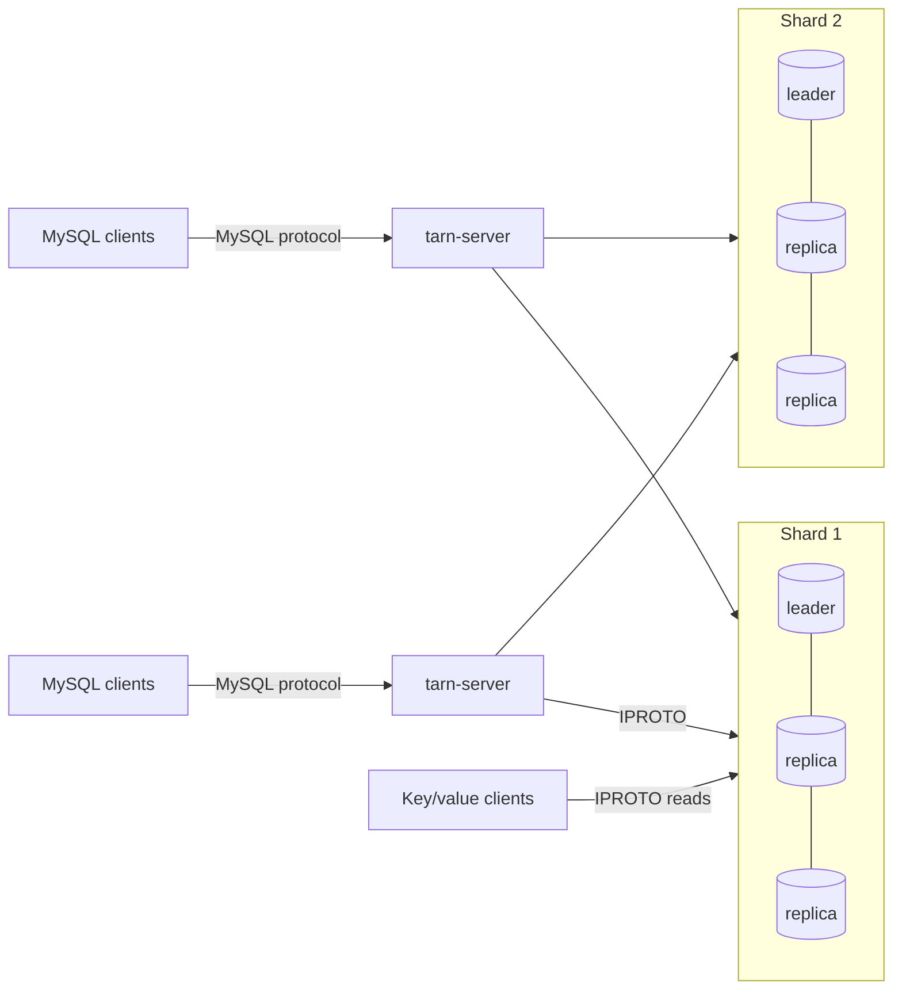

# Operations

How to deploy, configure and observe a Tarn cluster. Tarn is a research
prototype: read [Security](#security) and the limitations in the
[design document](design.md#6-limitations) before exposing it to anything
that matters.

## Topology



* **Storage nodes** are Tarantool 3.x instances running `lua/storage.lua`,
  which loads the Tarn module (`lua/tarn.lua`). A shard is one instance, or a
  replica set with synchronous replication (quorum ⌊N/2⌋+1) and Raft leader
  election. Each shard owns an equal, contiguous range of the 3,000 hash
  buckets.
* **`tarn-server`** is stateless. Run as many as you like (each with a
  distinct `--node-id`); each one finds every shard's leader by itself.
* **Key/value clients** read the spaces directly from any shard leader.

On real hardware, give each shard leader its own machine (Tarantool runs
transactions on one thread per instance) and put `tarn-server` next to the
clients or on the storage machines.

## Storage nodes

`lua/storage.lua` is configured through environment variables:

| Variable | Default | Meaning |
|---|---|---|
| `TARN_SHARD_ID` | `1` | shard number, 1..N |
| `TARN_LISTEN` | `127.0.0.1:3301` | IPROTO listen address |
| `TARN_LISTEN_UNIX` | | optional Unix socket to listen on as well |
| `TARN_WORKDIR` | `data` | data directory (WAL and snapshots) |
| `TARN_REPLICAS` | `[]` | JSON list of every replica URI of this shard; more than one enables synchronous replication and elections |
| `TARN_PEERS` | `{}` | JSON map of shard id to replica URIs for every shard (used by the recovery fiber) |
| `TARN_MEMORY_MB` | `1024` | memtx memory; the data set must fit in RAM |
| `TARN_WAL_MODE` | `write` | `write` (no fsync per commit, like `innodb_flush_log_at_trx_commit=2`), `fsync`, or `none` |
| `TARN_IPROTO_THREADS` | `1` | Tarantool network threads |
| `TARN_LOG_LEVEL` | `5` | Tarantool log level |

The bootstrap enables memtx MVCC, sets the default isolation to
`read-confirmed` (plain reads never see data that a failover could roll
back), and in replicated shards uses `election_mode = 'candidate'`,
`election_fencing_mode = 'strict'` and `replication_synchro_timeout = 5`.

Start every replica of a new shard before sending it traffic. Tarantool 3.9
stops a joining replica ("can't initialize storage: timed out") when its
first checkpoint waits longer than `replication_synchro_timeout` for the
confirmation of a synchronous transaction it received while joining. This
happened to replicas joining a newly started shard: when the leader's first
write could not reach its quorum because the replicas were still joining,
and once when a workload was already writing. (A replica joining an
established shard under 9,600 synchronous writes a second joined normally
in a local test.) Restart such a replica with an empty data directory. The
leader of a new shard waits (up to a minute) for its replicas to join
before its first synchronous write, and `scripts/cluster.sh start` returns
only once every replica has joined.

Protocol tunables live in `lua/tarn.lua` (`tarn.cfg`), and can be changed
at runtime from the Tarantool console (`tarn.cfg.lock_wait = 2`):

| Setting | Default | Meaning |
|---|---|---|
| `max_txn_age` | 120 s | PREPAREs of older transactions are refused; must match `max_txn_age` in `cluster.json` |
| `clock_skew` | 60 s | assumed bound on clock differences between nodes |
| `recovery_after` | 2 s | age at which an undecided cross-shard transaction is resolved by the recovery fiber |
| `recovery_interval` | 0.5 s | recovery and garbage-collection period |
| `lock_wait` | 1 s | how long an autocommit read or write waits for a conflicting prepared transaction before failing with 1213 |
| `gc_batch` | 500 | protocol records deleted per garbage-collection transaction |

Protocol records (participant and decision records of cross-shard
transactions) are kept for about `max_txn_age + clock_skew` after their last
change. At several thousand cross-shard commits per second that is on the
order of 100 MB of memtx memory per shard; size `TARN_MEMORY_MB` with it.

The storage user is `tarn` with password `tarn`, created by the module with
full privileges. Change it (`tarn.init{user=..., password=...}` in
`storage.lua`, and `user`/`password` in `cluster.json`) for anything but
local experiments.

## tarn-server

```
tarn-server (--config cluster.json | --shard ADDR[,ADDR..] ...)
            [--listen HOST:PORT]      default 127.0.0.1:3306
            [--threads N]             default: number of CPUs
            [--user NAME:PASSWORD]... MySQL accounts; without any, every login is accepted
            [--allow-all]             accept every login even with --user
            [--ack-on-prepare]        acknowledge cross-shard commits after PREPARE (see below)
            [--pool N]                connections per shard leader (default 4)
            [--node-id N]             distinguishes servers in transaction ids (default: pid)
            [--isolation LEVEL]       default level of new sessions (default SERIALIZABLE)
            [--lock-wait-timeout S]   default innodb_lock_wait_timeout, seconds (default 50)
```

`--shard` takes the comma-separated replica addresses of one shard and may
be repeated, one per shard in order. `cluster.json` says the same with more
options:

```json
{
  "shards": [
    {"id": 1, "replicas": ["10.0.0.11:3301", "10.0.0.12:3301", "10.0.0.13:3301"]},
    {"id": 2, "replicas": ["10.0.0.21:3301", "10.0.0.22:3301", "10.0.0.23:3301"]}
  ],
  "bucket_count": 3000,
  "user": "tarn", "password": "tarn",
  "pool_size": 4,
  "node_id": 1,
  "ack_on_prepare": false,
  "max_txn_age": 120,
  "isolation": "SERIALIZABLE",
  "lock_wait_timeout": 50,
  "deadlock_interval": 1.0
}
```

Replica addresses may be `unix/:/path/to/socket`. Logging uses
`tracing` filters from `TARN_LOG` (default `info`), e.g.
`TARN_LOG=tarn_sql=debug`.

`isolation` and `lock_wait_timeout` are the initial global values of
`transaction_isolation` and `innodb_lock_wait_timeout` (`SET GLOBAL` changes
them per SQL server until it restarts). `deadlock_interval` is how often, in
seconds, each SQL server looks for deadlocks that span shards (0 turns the
detector off; cycles within one shard are always detected at once).

**Ack-on-prepare** acknowledges a cross-shard commit as soon as every
participant has prepared (one round trip instead of two) and applies it in
the background. SQL readers still see strict serializability (they wait on
the transaction's locks); direct key/value readers may briefly not see a
just-acknowledged commit. The model checker covers both modes.

## Local clusters

`scripts/cluster.sh` runs everything on one machine for development and
benchmarks:

```
scripts/cluster.sh start [-n SHARDS] [-r REPLICAS] [-p SQL_PORT] [-s SQL_SERVERS]
                         [-m MEMORY_MB] [-w WAL_MODE] [-t THREADS] [-a] [-u]
                         [-d DIR] [-b BASE_PORT]
scripts/cluster.sh status [-d DIR]
scripts/cluster.sh stop   [-d DIR]
```

`-a` turns on ack-on-prepare and `-u` connects the SQL servers to storage
over Unix sockets. Storage instance *j* of shard *i* listens on
`BASE + 10·i + j` (default base 3300); SQL server *k* on `SQL_PORT + k − 1`.

## Monitoring

* `SHOW TARN STATUS` (or `SHOW STATUS LIKE 'Tarn%'`) on any SQL connection:
  statements, local / read-only / two-phase commits, conflicts, internal
  retries, plan-cache hits and misses, deadlocks across shards broken by
  this server, number of shards.
* `tarn_info()` on a storage node (from the Tarantool console or
  `net.box`): durable lock records and lock-index entries, prepared
  participants, participant and decision records held for garbage
  collection, row locks held (`row_locks`), and counters (`prepare_yes`,
  `prepare_no`, `apply`, `abort`, `conflicts`, `lock_waits`, `recovered`,
  `gc_part`, `gc_txn`, `validate_changed`; for row locks `plock_waits`,
  `deadlocks`, `lock_timeouts`, `commit_rc`, `commit_waits`).
* `protocol_errors` in `tarn_info().stats` must stay 0: a non-zero value
  means a storage node saw a protocol message that the commit protocol
  should make impossible (for example an APPLY for an aborted
  participant), and it is logged at error level.

## Failures and what clients see

| Event | Effect |
|---|---|
| Shard leader dies | A replica is elected in about 2–3 s. Statements on that shard fail meanwhile with 2003 (no reachable leader) or 1213; afterwards `tarn-server` uses the new leader. Committed data survives (quorum-replicated). |
| Leader demoted while connections stay open | The old leader answers `ER_READONLY`; `tarn-server` drops those connections and finds the new leader; open transactions abort with 1213. |
| Leader change or lost SQL-server connection while READ COMMITTED transactions hold row locks | The row locks live in the leader's memory and are released; each transaction that held some is rolled back with 1213 at its next statement on that shard or at commit, never committed without them. |
| `tarn-server` dies during a cross-shard commit | The storage nodes' recovery fiber finishes or aborts the transaction after `recovery_after`; its locks block conflicting statements until then. |
| Connection lost while a commit is in flight | The client gets 1180 / SQLSTATE 40003: the outcome is unknown, and the write is not re-sent. |
| A shard is down for a while | Transactions that touch it fail; rows of transactions that committed but were not yet applied there stay locked until it returns and recovery applies them. |
| Partitioned old leader | It steps down after the election timeout (`election_fencing_mode = 'strict'`); until then it may still answer autocommit reads from its own data (the usual leader-lease assumption). |

## Error codes

| Code | SQLSTATE | Meaning | Client action |
|---|---|---|---|
| 1213 | 40001 | serialization conflict, deadlock, leader change, row locks lost, or connection lost before anything was written; the transaction was rolled back | retry the transaction |
| 1205 | HY000 | lock wait timeout (`innodb_lock_wait_timeout`); only the statement was rolled back | retry the statement or roll back |
| 3572 | HY000 | `NOWAIT` and the row is locked; only the statement was rolled back | |
| 1305 | 42000 | no such savepoint | |
| 1568 | 25001 | `SET TRANSACTION` inside a transaction | |
| 1231 / 1232 | 42000 | bad value / type for a system variable | |
| 1180 | 40003 | connection to a shard lost during a commit: outcome unknown | check whether it was applied |
| 2003 | HY000 | a shard has no reachable leader | retry later |
| 1062 | 23000 | duplicate key | |
| 1264 | 22003 | value out of range for the column | |
| 1235 | 42000 | not supported | |
| 1153 | 08S01 | packet larger than 64 MiB | |
| 1461 | 42000 | too many prepared statements on the connection | close statements |
| 1045 | 28000 | access denied | |

## Security

* There is **no TLS** on either the MySQL or the storage connections.
  Run Tarn only on trusted networks.
* MySQL accounts come from the command line (`--user NAME:PASSWORD`, visible
  in the process list); without any, every login is accepted.
* The storage user `tarn`/`tarn` has full privileges on the storage nodes.
* See [SECURITY.md](../SECURITY.md) to report a vulnerability.
