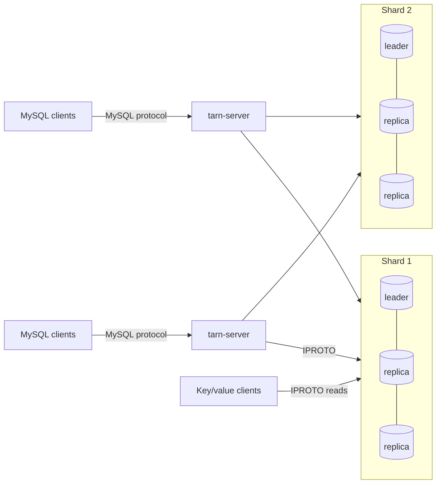

# Operations

How to deploy, configure and observe a Tarn cluster. Tarn is a research
prototype: read [Security](#security) and the limitations in the
[design document](design.md#6-limitations) before exposing it to anything
that matters.

## Topology



* **Storage nodes** are Tarantool 3.x instances running `lua/storage.lua`,
  which loads the Tarn module (`lua/tarn.lua`) and, when it is built, the
  native procedures' C module (`libtarn_storage.so`, from
  `crates/tarn-storage`). A shard is one instance, or a
  replica set with synchronous replication (quorum ⌊N/2⌋+1) and Raft leader
  election. Rows are hashed into buckets (30,000 in a new cluster); each
  shard owns some of them (an equal, contiguous range in a new cluster),
  and buckets move between shards online ([Buckets](#buckets)).
* **`tarn-server`** is stateless. Run as many as you like (each with a
  distinct `--node-id`); each one finds every shard's leader by itself.
* **Key/value clients** read the spaces directly from any shard leader.

On real hardware, give each shard leader its own machine (Tarantool runs
transactions on one thread per instance) and put `tarn-server` next to the
clients or on the storage machines.

## Storage nodes

`lua/storage.lua` is configured through environment variables:

| Variable | Default | Meaning |
|---|---|---|
| `TARN_SHARD_ID` | `1` | shard number, 1..N |
| `TARN_LISTEN` | `127.0.0.1:3301` | IPROTO listen address |
| `TARN_LISTEN_UNIX` | | optional Unix socket to listen on as well |
| `TARN_WORKDIR` | `data` | data directory: WAL, snapshots and vinyl's files |
| `TARN_REPLICAS` | `[]` | JSON list of every replica URI of this shard; more than one enables synchronous replication and elections |
| `TARN_PEERS` | `{}` | JSON map of shard id to replica URIs for every shard (used by the recovery fiber; shards added with `TARN ADD SHARD` are found in the membership) |
| `TARN_MEMORY_MB` | `1024` | memtx memory: memtx tables, the protocol's records and the system spaces |
| `TARN_VINYL_MEMORY_MB` | `128` | vinyl's in-memory level: recent writes of vinyl tables, dumped to disk when full |
| `TARN_VINYL_CACHE_MB` | `128` | vinyl's cache of recently read rows |
| `TARN_VINYL_READ_THREADS` | the CPUs divided among `TARN_HOST_INSTANCES`, 1 to 8 | threads reading vinyl pages from disk (`vinyl_read_threads`): see [Sizing](#sizing) |
| `TARN_HOST_INSTANCES` | `1` | storage instances sharing this machine, for the default of `TARN_VINYL_READ_THREADS` (`scripts/cluster.sh` sets it) |
| `TARN_VINYL_WRITE_THREADS`, `TARN_VINYL_PAGE_SIZE`, `TARN_VINYL_RANGE_SIZE`, `TARN_VINYL_BLOOM_FPR` | Tarantool's | the `vinyl_*` options of those names: threads for dumps and compaction, page and range size of new indexes, bloom filter false-positive rate |
| `TARN_WAL_MODE` | `write` | `write` (no fsync per commit, like `innodb_flush_log_at_trx_commit=2`), `fsync`, or `none` |
| `TARN_IPROTO_THREADS` | `1` | Tarantool network threads |
| `TARN_LOG_LEVEL` | `5` | Tarantool log level |
| `TARN_LOAD_WINDOW` | `60` | seconds per window of the requests counted for each bucket: `TARN REBALANCE BY LOAD` sees the last one to two windows |
| `TARN_NATIVE` | `target/release/libtarn_storage.so` of the checkout, if it was built | the native procedures' module ([design §1.5](design.md#15-native-procedures)), which serves the most frequent reads without running Lua; `0`: none, the Lua procedures serve every request. The file must be named `libtarn_storage.so`. |

The bootstrap enables memtx MVCC, sets the default isolation to
`read-confirmed` (plain reads never see data that a failover could roll
back), and in replicated shards uses `election_mode = 'candidate'`,
`election_fencing_mode = 'strict'` and `replication_synchro_timeout = 5`.

Start every replica of a new shard before sending it traffic. Tarantool 3.9
stops a joining replica ("can't initialize storage: timed out") when its
first checkpoint waits longer than `replication_synchro_timeout` for the
confirmation of a synchronous transaction it received while joining. This
happened to replicas joining a newly started shard: when the leader's first
write could not reach its quorum because the replicas were still joining,
and once when a workload was already writing. (A replica joining an
established shard under 9,600 synchronous writes a second joined normally
in a local test.) Restart such a replica with an empty data directory. The
leader of a new shard waits (up to a minute) for its replicas to join
before its first synchronous write, and `scripts/cluster.sh start` returns
only once every replica has joined.

Protocol tunables live in `lua/tarn.lua` (`tarn.cfg`), and can be changed
at runtime from the Tarantool console (`tarn.cfg.lock_wait = 2`):

| Setting | Default | Meaning |
|---|---|---|
| `max_txn_age` | 120 s | PREPAREs of older transactions are refused; must match `max_txn_age` in `cluster.json` |
| `clock_skew` | 60 s | assumed bound on clock differences between nodes |
| `recovery_after` | 2 s | age at which an undecided cross-shard transaction is resolved by the recovery fiber |
| `recovery_interval` | 0.5 s | recovery and garbage-collection period |
| `lock_wait` | 1 s | how long an autocommit read or write waits for a conflicting prepared transaction before failing with 1213 |
| `gc_batch` | 500 | protocol records deleted per garbage-collection transaction |
| `alter_check_rows` | 1,000,000 | `ALTER TABLE` refuses (1846) to check the existing rows of a table (a narrower type, `NOT NULL`) when a shard holds more of them than this: writes to the table wait for the whole scan |

Protocol records (participant and decision records of cross-shard
transactions) are kept for about `max_txn_age + clock_skew` after their last
change. At several thousand cross-shard commits per second that is on the
order of 100 MB of memtx memory per shard; size `TARN_MEMORY_MB` with it.

The storage user is `tarn` with password `tarn`, created by the module with
full privileges. Change it (`tarn.init{user=..., password=...}` in
`storage.lua`, and `user`/`password` in `cluster.json`) for anything but
local experiments.

### Sizing

**memtx.** `TARN_MEMORY_MB` holds every row of the memtx tables, the
protocol's records (see above) and the system spaces.

**vinyl.** The rows of a vinyl table are on disk. Besides memtx, a storage
node's RAM holds:

| What | Size | Set with |
|---|---|---|
| Recent writes, dumped to disk when full (the in-memory level) | fixed | `TARN_VINYL_MEMORY_MB`, 128 MB |
| Recently read rows (the cache) | fixed | `TARN_VINYL_CACHE_MB`, 128 MB |
| The page index and bloom filters of every file on disk | grows with the data | `TARN_VINYL_PAGE_SIZE`, `TARN_VINYL_BLOOM_FPR` |

Measured on two shards holding four sysbench tables of 500,000 rows each
(`oltp_common`: an `INT` primary key, a secondary index on `k`, a `CHAR(120)`
and a `CHAR(60)` column), loaded through SQL with the default vinyl
settings, then checkpointed:

| One shard, 1,000,000 rows | |
|---|---:|
| Rows (the primary index), uncompressed | 201 MB |
| The secondary index, uncompressed, with page indexes and bloom filters | 50 MB |
| Files on disk | 131 MB |
| Page indexes in RAM | 1.6 MB |
| Bloom filters in RAM | 1.0 MB |
| Resident memory of the storage process | 213 and 229 MB |

* **RAM grows with the data** by the page indexes and bloom filters: 2.6 MB
  per million rows here, about 1% of the uncompressed rows and 2% of the
  files on disk. A shard holding a billion such rows needs about 2.6 GB for
  them before any cache. The page index has an entry per page
  (`TARN_VINYL_PAGE_SIZE`, 8 KB by default); the bloom filters grow with the
  number of keys (`TARN_VINYL_BLOOM_FPR`, a 5% false-positive rate by
  default). Larger pages shrink the page index but make each point read
  fetch more from disk; a higher false-positive rate shrinks the filters but
  sends more lookups of absent keys to disk. Both settings apply to indexes
  created afterwards.
* **The cache decides how many reads go to disk.** A read that misses it
  reads a page from disk on one of `TARN_VINYL_READ_THREADS`, taken in
  turn. With data ten times the cache, point selects ran at 72% of their
  cached rate and range scans at 62%, while single-row writes
  kept theirs ([bench/RESULTS.md](../bench/RESULTS.md); files on tmpfs, so
  a miss read memory and the figures leave out disk latency).
* **Reader threads.** Tarantool reads with one thread unless told
  otherwise, and every miss then waits for the one before it. A storage
  instance defaults to the machine's CPUs divided by `TARN_HOST_INSTANCES`,
  at least 1 and at most 8: the readers spend their time waiting on the disk
  and decompressing pages, and past 8 the shard's transaction thread is the
  limit. Point selects by primary key of a vinyl table holding 13 times its
  cache:

  | `vinyl_read_threads` | 8 clients | 32 clients |
  |---|---:|---:|
  | 1 (Tarantool's default) | 8.6k/s | |
  | 8 | 25.3k/s | 39.8k/s |

  Set `TARN_HOST_INSTANCES` when several storage instances share a machine,
  or `TARN_VINYL_READ_THREADS` itself: higher for a disk with deep queues
  (network block storage), lower to leave cores to other processes. With
  everything in the cache the threads stay idle.
* **Disk.** Vinyl compresses pages (zstd) when it compacts them. Dumps are
  written uncompressed, so recent writes take more space until compaction
  merges them. Compaction writes a range's new files before dropping the old
  ones, and Tarantool deletes dropped files only once no checkpoint it keeps
  uses them: Tarn checkpoints hourly and Tarantool keeps the last two. The
  WAL also keeps every write since the oldest kept checkpoint. Leave free
  space of about the size of the data, plus the WAL of two hours of writes.
* **CPU.** A shard runs its transactions on one thread. Dumps and
  compaction, compression included, run on `TARN_VINYL_WRITE_THREADS` (4 by
  default, Tarantool's; they run in the background, so no read or commit
  waits on them the way a cache miss waits on a reader). Give each shard
  leader a core for its transactions and leave cores for these threads.
* **Replicas** each hold a full copy of their shard: size every replica like
  its leader.

## tarn-server

```
tarn-server (--config cluster.json | --shard ADDR[,ADDR..] ...)
            [--listen HOST:PORT]      default 127.0.0.1:3306
            [--threads N]             default: number of CPUs
            [--user NAME:PASSWORD]... MySQL accounts; without any, every login is accepted
            [--allow-all]             accept every login even with --user
            [--ack-on-prepare]        acknowledge cross-shard commits after PREPARE (see below)
            [--pool N]                connections per shard leader (default 4)
            [--node-id N]             distinguishes servers in transaction ids (default: pid)
            [--isolation LEVEL]       default level of new sessions (default SERIALIZABLE)
            [--lock-wait-timeout S]   default innodb_lock_wait_timeout, seconds (default 50)
            [--default-engine E]      memtx or vinyl: tables without ENGINE= (default memtx)
            [--default-collation C]   collation of text in tables that name none (default utf8mb4_bin)
tarn-server --check-schema FILE [--database DB] [--default-collation C]
```

`--check-schema` checks the table trees a schema file declares
([table trees](sql-compatibility.md#table-trees)) without a cluster: it
reads the file's `CREATE DATABASE`, `USE` and `CREATE TABLE` statements,
prints one line per finding, and exits 1 when there is a warning (2 when
the file cannot be read or a table in it cannot be planned). `--database`
names the database of tables before any `USE`.

`--shard` takes the comma-separated replica addresses of one shard and may
be repeated, one per shard in order. `cluster.json` says the same with more
options:

```json
{
  "shards": [
    {"id": 1, "replicas": ["10.0.0.11:3301", "10.0.0.12:3301", "10.0.0.13:3301"]},
    {"id": 2, "replicas": ["10.0.0.21:3301", "10.0.0.22:3301", "10.0.0.23:3301"]}
  ],
  "bucket_count": 30000,
  "user": "tarn", "password": "tarn",
  "pool_size": 4,
  "node_id": 1,
  "ack_on_prepare": false,
  "max_txn_age": 120,
  "isolation": "SERIALIZABLE",
  "lock_wait_timeout": 50,
  "deadlock_interval": 1.0,
  "ddl_job_stale": 30,
  "move_timeout": 10,
  "default_collation": "utf8mb4_bin"
}
```

`default_collation` (`--default-collation`) is the collation of text
columns in tables that declare none (`@@collation_server`); MySQL's own
default is case-insensitive (`utf8mb4_general_ci` in MariaDB,
`utf8mb4_0900_ai_ci` in MySQL 8). Like the default engine it is read when a
table is created, so give every SQL server the same one. Tables keep the
collations they were created with.

Replica addresses may be `unix/:/path/to/socket`. Logging uses
`tracing` filters from `TARN_LOG` (default `info`), e.g.
`TARN_LOG=tarn_sql=debug`.

`isolation` and `lock_wait_timeout` are the initial global values of
`transaction_isolation` and `innodb_lock_wait_timeout` (`SET GLOBAL` changes
them per SQL server until it restarts). `deadlock_interval` is how often, in
seconds, each SQL server looks for deadlocks that span shards, starting from
its own transactions' lock waits (0 turns the detector off; cycles within
one shard are always detected at once). A server whose transactions do not
wait for row locks calls no shard for it, so a smaller interval, which
finds such deadlocks sooner, costs storage calls only while lock waits last.

`ddl_job_stale` is how long, in seconds, a schema change (`CREATE TABLE`,
`DROP TABLE`, `TRUNCATE`, `ALTER TABLE`) may go without its SQL server
touching it before another server takes it over and finishes it: back if
not every shard had prepared it, forward if every shard had (`docs/design.md`
§2.10). Every server looks for such jobs at startup and every
`ddl_job_stale / 2` seconds (at most 10).

`bucket_count` is the number of buckets of a new cluster (default 30,000).
The first SQL server to start on a new cluster makes the bucket map with it,
and from then on it cannot change: every row's `bucket_id` depends on it.
Later servers use the map's count (one whose `bucket_count` differs logs a
warning). A cluster made by a version from before bucket moves keeps the
count its rows were stored with: 3,000, that version's default, or the
`bucket_count` its configuration set -- keep that setting. See
[Buckets](#buckets) for choosing it.

`move_timeout` is how long, in seconds, a bucket move waits at each of its
steps for the transactions that hold locks on the bucket's rows before it
gives up (see [Buckets](#buckets)).

**Ack-on-prepare** acknowledges a cross-shard commit as soon as every
participant has prepared (one round trip instead of two) and applies it in
the background. SQL readers still see strict serializability (they wait on
the transaction's locks); direct key/value readers may briefly not see a
just-acknowledged commit. The model checker covers both modes.

## Buckets

A row's bucket is a hash of its shard key; a shard owns a set of buckets,
and buckets move between shards while the cluster serves. The shards keep
the map: the first SQL server to start on a new cluster -- or on one made by
a version without bucket moves -- gives each shard an equal, contiguous
range of buckets, and from then on only moves change it. SQL servers read
the map when they start, and again when a shard refuses a request for a
bucket it no longer owns.

```sql
SHOW TARN BUCKETS;                               -- per shard: buckets, ranges, epoch, moves in progress
TARN MOVE BUCKET 1614 TO SHARD 2;
TARN MOVE BUCKETS BETWEEN 2001 AND 3000 TO SHARD 3;   -- one at a time; those already there stay
```

A move copies the bucket's rows to the new shard while the old one serves
them, then fences the bucket on the old shard -- writes and row locks on its
rows are refused from then on, and the row locks held on them are broken --,
waits for the transactions holding locks on its rows, copies the rows
written since the copy began, deletes the rows on the old shard and inserts
them on the new one. Clients see this as follows: an autocommit statement,
or the first statement of a transaction, that meets the move runs again
with the new map (`Tarn_retries`); a transaction that already used the
bucket's rows is rolled back with 1213, as after a leader change. Writes to
the bucket wait from its fence to its switch: the time to drain the
prepared transactions that hold its rows' locks and to copy the last
writes. A step that waits longer than `move_timeout` gives the move up
(1205): the bucket stays where it was. A move survives leader changes of
either shard (it copies the bucket again if the old shard's leader changed
while it copied), and if its SQL server stops, another server finishes it
after `ddl_job_stale`: back if the old shard had not deleted the rows yet,
forward otherwise. Moves and schema changes wait for each other; while a
schema change (or a change of the cluster's shards) waits for moves to end,
no new move begins.

To **add a shard**, start its storage nodes with a new shard id, then, on
any SQL server:

```sql
TARN ADD SHARD 3 '10.0.0.31:3301,10.0.0.32:3301';   -- its id and replicas, as --shard takes them
SHOW TARN SHARDS;                                   -- the cluster's shards: id, replicas, state (active, draining, removed)
TARN MOVE BUCKETS BETWEEN 1 AND 10000 TO SHARD 3;
```

`TARN ADD SHARD` checks that the node is a storage node of that shard with
no buckets and no tables but the cluster's (a run that stopped halfway can
run again), creates every table there as the first shard has it, gives it a
bucket map with no buckets, and then records the new membership on every
shard; the shard serves nothing until buckets move to it. It runs as a job:
schema changes and moves wait for it, and it waits for them. The other SQL
servers need no restart and no change of configuration: they learn the new
shard from the shards -- when a shard refuses a request routed with the
membership from before, when they read the bucket map, and when they start
-- and a transaction that read every shard before it joined cannot commit
once buckets can have moved to it (see design §2.13). Buckets move to the
cluster's members only: once a shard has joined with `TARN ADD SHARD`, a
shard added only to the SQL servers' configuration gets none.

To **remove a shard**, run on any SQL server:

```sql
TARN REMOVE SHARD 2;   -- its buckets move to the other shards, then it leaves
```

It marks the shard *draining* on every shard: no bucket moves to it from
then on, and it decides no new transaction (participants refuse it as a
decision shard, whose outcome they would have to ask it for). Its buckets
then move to the active shards, eight at a time, each to the one with the
fewest; it waits until no participant still needs the shard to learn an
outcome, and marks it *removed* on every shard. From then on the SQL
servers leave it out -- they learn it as they learn of a shard that joins,
or when the shard cannot be reached -- and its storage can be stopped; a
server whose configuration still lists it starts without it. The first
shard of the configuration keeps the cluster's jobs and catalog and cannot
be removed. A `TARN REMOVE SHARD` that stops (an error, a lost connection)
goes on when run again.

To **rebalance** -- after adding a shard, or when the shards' sizes have
drifted apart --, run on any SQL server:

```sql
TARN REBALANCE;                                  -- by size, four moves at a time
TARN REBALANCE BY LOAD MAX MOVES 2 MAX RATE 50000000;   -- by requests; at most 50 MB/s of buckets
SHOW TARN REBALANCE;     -- status, owner, moves done and failed, planned, moving, bytes moved, limits
SHOW TARN MOVES;         -- the current (or last) round's moves: bucket, from, to, bytes, state (planned, copying, fenced, done, failed)
SELECT * FROM information_schema.TARN_MOVES WHERE STATE = 'failed';
TARN REBALANCE PAUSE;    -- the moves in flight end; no new one starts
TARN REBALANCE RESUME;
TARN REBALANCE CANCEL;   -- the planned moves are dropped
```

A rebalance runs in the background, one at a time in the cluster, and
plans in rounds of up to 64 moves: from the shards' sizes (`BY SIZE`, the
default: each bucket's rows and their bytes, which the shards count) or
from their load (`BY LOAD`: each bucket's reads and written rows over the
last one to two minutes, `TARN_LOAD_WINDOW`), it moves buckets from the
heaviest active shard to the lightest -- the bucket that best halves the
gap between them -- until the shards are even within a bucket's average
weight or 2% of a shard's share, whichever is more. A bucket's weight also
counts that average, so the shards end with even shares of the buckets as
well: the rows written later spread over them. Each round reads the sizes
again; the rebalance ends (`done`) when a round finds nothing to move.
`MAX MOVES` (1 to 64, default 4) bounds the moves in flight and `MAX RATE`
the bytes per second of the buckets moved (default: no limit). Each move is
a `TARN MOVE BUCKET`: a move that fails is shown with its error and the
rebalance goes on (it fails after ten failures in a row); a move that waits
for a schema change is planned again for later. The rebalance runs on the
SQL server that started it; if that server stops, another one takes it over
after `ddl_job_stale` and goes on, as it does for a paused one. Moves only
go to active shards: a rebalance can run while a shard is being removed,
and leaves that shard's buckets to the drain.

Before moving buckets, every SQL server must run a version with bucket
moves and know every shard: an older server names no buckets in its
requests (shards refuse its writes by their rows' `bucket_id`, but its
reads are not checked). Likewise, before adding or removing a shard, every
SQL server must run a version with `TARN ADD SHARD`: an older one names no
membership version, so its reads of every shard are not checked.

Key/value clients that compute a row's shard themselves find each bucket's
shard in `tarn_buckets()` on the shards (or in `SHOW TARN BUCKETS`), or ask
every shard.

**How many buckets.** A shard owns whole buckets, so the shards' sizes can
differ by a bucket, one part in the number of buckets per shard: 3,000
buckets on 300 shards are 10 per shard, so a shard with 11 holds 10% more
than one with 10; 30,000 buckets make that 1%. (Rows with one shard key
value stay in one bucket whatever the count: more buckets do not split a
hot key.) More buckets cost more moves for the same share of rows -- each
move is one job of about a dozen storage calls, plus the copy -- and a
record per bucket on its shard and an entry in each SQL server's map. The
count is fixed when the cluster is made (`bucket_count`), so choose it for
the largest number of shards the cluster may grow to: about 100 buckets per
shard or more.

## Local clusters

`scripts/cluster.sh` runs everything on one machine for development and
benchmarks:

```
scripts/cluster.sh start [-n SHARDS] [-r REPLICAS] [-p SQL_PORT] [-s SQL_SERVERS]
                         [-m MEMORY_MB] [-w WAL_MODE] [-t THREADS] [-a] [-u]
                         [-d DIR] [-b BASE_PORT]
scripts/cluster.sh status [-d DIR]
scripts/cluster.sh stop   [-d DIR]
scripts/cluster.sh restart [-d DIR] INSTANCE...   # a stopped instance: s2.1, tarn1
scripts/cluster.sh add-shard [-d DIR] I           # storage for shard I; prints its replicas
```

`-a` turns on ack-on-prepare and `-u` connects the SQL servers to storage
over Unix sockets. Storage instance *j* of shard *i* listens on
`BASE + 10·i + j` (default base 3300); SQL server *k* on `SQL_PORT + k − 1`.

## Monitoring

* `SHOW TARN STATUS` (or `SHOW STATUS LIKE 'Tarn%'`) on any SQL connection:
  statements, local / read-only / two-phase commits, conflicts, internal
  retries, plan-cache hits and misses, deadlocks across shards broken by
  this server, storage calls its deadlock detector made
  (`Tarn_deadlock_detector_calls`: none while no lock wait lasts), `COUNT`s
  the shards computed without returning rows (`Tarn_storage_counts`), rows
  read from storage (`Tarn_rows_read`), attempted storage reads (`Tarn_storage_reads`,
  one per index-scan or multi-key page or co-located join request, including
  failed or discarded attempts), row counts taken to choose between
  an ordered page and a longer index prefix (`Tarn_path_estimates`), buckets
  this server moved (`Tarn_bucket_moves`) and how many times it read the
  bucket map (`Tarn_bucket_map_reads`), the number of buckets
  (`Tarn_buckets`), number of shards. `SHOW TARN BUCKETS` lists each
  shard's buckets and the moves in progress, `SHOW TARN SHARDS` the
  cluster's shards (`tarn_members()` on a storage node: the membership
  and its version).
* `tarn_info()` on a storage node (from the Tarantool console or
  `net.box`): durable lock records and lock-index entries, prepared
  participants, participant and decision records held for garbage
  collection, row locks held (`row_locks`), tables held by a `TRUNCATE` or
  `DROP TABLE` in progress (`ddl_held`), and counters (`prepare_yes`,
  `prepare_no`, `apply`, `abort`, `conflicts`, `lock_waits`, `recovered`,
  `gc_part`, `gc_txn`, `validate_changed`; for row locks `plock_waits`,
  `deadlocks`, `lock_timeouts`, `commit_rc`, `commit_waits`; for buckets
  `buckets` and `bucket_epoch`, and the counters `moved` (requests refused
  for their bucket), `move_broken_locks`, `bucket_sends`, `bucket_recvs`),
  and `native`: false without the native procedures, else whether they are
  in use (`ready`), the reads they served (`served`) and those they handed
  to the Lua procedure (`to_lua`).
* `protocol_errors` in `tarn_info().stats` must stay 0: a non-zero value
  means a storage node saw a protocol message that the commit protocol
  should make impossible (for example an APPLY for an aborted
  participant), and it is logged at error level.

## Failures and what clients see

| Event | Effect |
|---|---|
| Shard leader dies | A replica is elected in about 2–3 s. Statements on that shard fail meanwhile with 2003 (no reachable leader) or 1213; afterwards `tarn-server` uses the new leader. Committed data survives (quorum-replicated). |
| Leader demoted while connections stay open | The old leader answers `ER_READONLY`; `tarn-server` drops those connections and finds the new leader; open transactions abort with 1213. |
| Leader change or lost SQL-server connection while READ COMMITTED transactions hold row locks | The row locks live in the leader's memory and are released; each transaction that held some is rolled back with 1213 at its next statement on that shard or at commit, never committed without them. |
| `tarn-server` dies during a cross-shard commit | The storage nodes' recovery fiber finishes or aborts the transaction after `recovery_after`; its locks block conflicting statements until then. |
| Connection lost while a commit is in flight | The client gets 1180 / SQLSTATE 40003: the outcome is unknown, and the write is not re-sent. |
| A shard is down for a while | Transactions that touch it fail; rows of transactions that committed but were not yet applied there stay locked until it returns and recovery applies them. |
| A shard fails during `CREATE TABLE`, `DROP TABLE`, `TRUNCATE` or `ALTER TABLE` | Before every shard prepared: the statement fails and the change is undone on every shard (once the shard is back, for that shard). After: the statement reports 1180 and the change is completed on every shard once the shard is back. Either way a SQL server finishes the job by itself (`ddl_job_stale`); until then, other schema changes of the same table wait. |
| A bucket moves | Statements that meet it run again with the new map; a transaction that used its rows while it moved is rolled back with 1213. Writes to its rows wait from the move's fence to its switch. |
| A move's SQL server stops, or a shard leader dies during a move | Another SQL server finishes the move after `ddl_job_stale`: back if the old shard had not sent the bucket, forward otherwise; a leader change alone does not stop a move. |
| Partitioned old leader | It steps down after the election timeout (`election_fencing_mode = 'strict'`); until then it may still answer autocommit reads from its own data (the usual leader-lease assumption). |

## Error codes

| Code | SQLSTATE | Meaning | Client action |
|---|---|---|---|
| 1213 | 40001 | serialization conflict, deadlock, leader change, row locks lost, a bucket the transaction used moved, or connection lost before anything was written; the transaction was rolled back | retry the transaction |
| 1205 | HY000 | lock wait timeout (`innodb_lock_wait_timeout`); only the statement was rolled back | retry the statement or roll back |
| 3572 | HY000 | `NOWAIT` and the row is locked; only the statement was rolled back | |
| 1305 | 42000 | no such savepoint | |
| 1568 | 25001 | `SET TRANSACTION` inside a transaction | |
| 1231 / 1232 | 42000 | bad value / type for a system variable | |
| 1180 | 40003 | connection to a shard lost during a commit: outcome unknown | check whether it was applied |
| 2003 | HY000 | a shard has no reachable leader | retry later |
| 1062 | 23000 | duplicate key | |
| 1264 | 22003 | value out of range for the column | |
| 1235 | 42000 | not supported | |
| 1105 | HY000 | under `tarn_tree_checks = 'ERROR'`: a declared [table tree](sql-compatibility.md#table-trees) does not line up (otherwise a warning) | fix the keys or `PARTITION BY KEY` |
| 1153 | 08S01 | packet larger than 64 MiB | |
| 1461 | 42000 | too many prepared statements on the connection | close statements |
| 1045 | 28000 | access denied | |

## Security

* There is **no TLS** on either the MySQL or the storage connections.
  Run Tarn only on trusted networks.
* MySQL accounts come from the command line (`--user NAME:PASSWORD`, visible
  in the process list); without any, every login is accepted.
* The storage user `tarn`/`tarn` has full privileges on the storage nodes.
* See [SECURITY.md](../SECURITY.md) to report a vulnerability.
