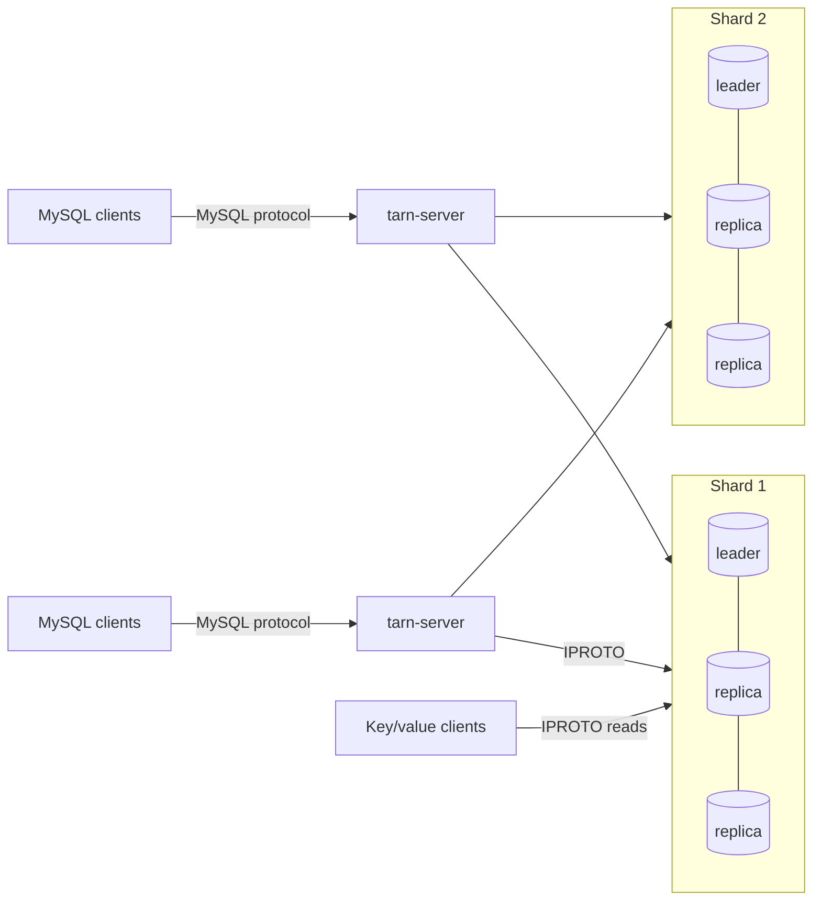

# Operations

How to deploy, configure and observe a Tarn cluster. Tarn is a research
prototype: read [Security](#security) and the limitations in the
[design document](design.md#6-limitations) before exposing it to anything
that matters.

[Rolling upgrades](upgrades.md) defines the supported predecessor, component
matrix, connection admission, health gates and rollback boundary. Storage
runtime admission currently requires Tarantool 3.9.0.

## Topology



* **Storage nodes** are Tarantool 3.x instances running `lua/storage.lua`,
  which loads the Tarn module (`lua/tarn.lua`) and, when it is built, the
  native procedures' C module (`libtarn_storage.so`, from
  `crates/tarn-storage`). A shard is one instance, or a
  replica set with synchronous replication (quorum ⌊N/2⌋+1) and Raft leader
  election. Rows are hashed into buckets (30,000 in a new cluster); each
  shard owns some of them (an equal, contiguous range in a new cluster),
  and buckets move between shards online ([Buckets](#buckets)).
* **`tarn-server`** is stateless. Run as many as you like (each with a
  distinct `--node-id`); each one finds every shard's leader by itself.
* **Key/value clients** can read the spaces directly. Such raw reads have no
  Tarn freshness barrier: even with `read-confirmed` visibility a follower
  or former leader can return old committed tuples. Use the strong storage
  procedures or SQL when freshness and protocol lock checks are required.

On real hardware, give each shard leader its own machine (Tarantool runs
transactions on one thread per instance) and put `tarn-server` next to the
clients or on the storage machines.

For gateway socket, fanout, encoded-response and diagnostic polling limits,
see [Gateway resource limits](gateway-resources.md). `pool_size` is a lazy
per-leader maximum; the `topology` object supplies gateway-wide caps.

## Storage nodes

`lua/storage.lua` is configured through environment variables:

| Variable | Default | Meaning |
|---|---|---|
| `TARN_SHARD_ID` | `1` | shard number, 1..N |
| `TARN_LISTEN` | `127.0.0.1:3301` | IPROTO listen address |
| `TARN_LISTEN_UNIX` | | optional Unix socket to listen on as well |
| `TARN_WORKDIR` | `data` | data directory: WAL, snapshots and vinyl's files |
| `TARN_INSTANCE_UUID`, `TARN_INSTANCE_NAME` | derived / unset | stable registered identity for a backup-seeded replica |
| `TARN_ELECTION_MODE` | `candidate` with replicas | `candidate` or `voter` with replicas; `off` for a standalone instance; seeded copies require `voter` |
| `TARN_REPLICAS` | `[]` | JSON list of every replica URI of this shard; more than one enables synchronous replication and elections |
| `TARN_PEERS` | `{}` | JSON map of shard id to replica URIs for every shard (used by the recovery fiber; shards added with `TARN ADD SHARD` are found in the membership) |
| `TARN_MAX_TXN_AGE` | `120` | immutable timing policy `A`, seconds; must match the gateway's `max_txn_age` |
| `TARN_CLOCK_SKEW` | `60` | immutable timing policy `S`, seconds; the assumed cross-node/issuer clock bound |
| `TARN_CLOCK_MAX_GAP` | `2` | immutable local observation-gap/certificate lifetime, seconds |
| `TARN_CLOCK_MAX_DRIFT` | `0.25` | immutable wall/monotonic elapsed-time drift allowance, seconds |
| `TARN_MEMORY_MB` | `1024` | memtx memory: memtx tables, the protocol's records and the system spaces |
| `TARN_VINYL_MEMORY_MB` | `128` | vinyl's in-memory level: recent writes of vinyl tables, dumped to disk when full |
| `TARN_VINYL_CACHE_MB` | `128` | vinyl's cache of recently read rows |
| `TARN_VINYL_TIMEOUT` | `0.25` | seconds a native vinyl statement may wait for memory quota; Tarantool's standalone default is 60 seconds. This is not a whole-transaction, disk-I/O or replication deadline. |
| `TARN_VINYL_READ_THREADS` | the CPUs divided among `TARN_HOST_INSTANCES`, 1 to 8 | threads reading vinyl pages from disk (`vinyl_read_threads`): see [Sizing](#sizing) |
| `TARN_HOST_INSTANCES` | `1` | storage instances sharing this machine, for the default of `TARN_VINYL_READ_THREADS` (`scripts/cluster.sh` sets it) |
| `TARN_VINYL_WRITE_THREADS`, `TARN_VINYL_PAGE_SIZE`, `TARN_VINYL_RANGE_SIZE`, `TARN_VINYL_BLOOM_FPR` | Tarantool's | the `vinyl_*` options of those names: threads for dumps and compaction, page and range size of new indexes, bloom filter false-positive rate |
| `TARN_WAL_MODE` | `write` | `write` (no fsync per commit, like `innodb_flush_log_at_trx_commit=2`), `fsync`, or `none` |
| `TARN_IPROTO_THREADS` | `1` | Tarantool network threads |
| `TARN_LOG_LEVEL` | `5` | Tarantool log level |
| `TARN_LOAD_WINDOW` | `60` | seconds per window of the requests counted for each bucket: `TARN REBALANCE BY LOAD` sees the last one to two windows |
| `TARN_NATIVE` | `target/release/libtarn_storage.so` of the checkout, if it was built | the native procedures' module ([design §1.5](design.md#15-native-procedures)), which serves the most frequent reads and autocommit writes without running Lua; `0`: none, the Lua procedures serve every request. The file must be named `libtarn_storage.so`. |

Set the four timing values consistently on every replica before its first
policy is installed. Startup validates finite, nonnegative values, positive
age/gap, drift below gap and the supported retention bound before
`box.cfg`. Existing persisted policy must still match: changing environment
variables or restarting does not replace it, lower its high-water mark or
clear a fault. There is no policy-reset API. See
[clock health and retention](#clock-health-and-record-retention).

The bootstrap enables memtx MVCC, sets the default isolation to
`read-confirmed` (plain reads never see data that a failover could roll
back), and in replicated shards uses `election_mode = 'candidate'`,
`election_fencing_mode = 'strict'` and `replication_synchro_timeout = 5`.

Start every replica of a new shard before sending it traffic. Tarantool 3.9
stops a joining replica ("can't initialize storage: timed out") when its
first checkpoint waits longer than `replication_synchro_timeout` for the
confirmation of a synchronous transaction it received while joining. This
happened to replicas joining a newly started shard: when the leader's first
write could not reach its quorum because the replicas were still joining,
and once when a workload was already writing. (A replica joining an
established shard under 9,600 synchronous writes a second joined normally
in a local test.) Restart such a replica with an empty data directory. The
leader of a new shard waits (up to a minute) for its replicas to join
before its first synchronous write, and `scripts/cluster.sh start` returns
only once every replica has joined.

Protocol tunables live in `lua/tarn.lua` (`tarn.cfg`). Ordinary settings such
as `tarn.cfg.lock_wait = 2` can be changed at runtime. The clock-policy
settings below are persisted and immutable once installed; changing their
configured values makes admission fail closed rather than rewriting history.

| Setting | Default | Meaning |
|---|---|---|
| `max_txn_age` | 120 s | immutable policy: age limit for fresh PREPARE; must match `max_txn_age` in `cluster.json` |
| `clock_skew` | 60 s | immutable policy: assumed cross-node/issuer bound `S`; record retention uses two margins |
| `clock_max_gap` | 2 s | immutable policy: local observation-gap bound and clock-certificate lifetime |
| `clock_max_drift` | 0.25 s | immutable policy: allowed difference between raw-wall displacement from the previous logical wall and monotonic elapsed time |
| `read_freshness_timeout` | 5 s | fresh autocommit quorum-barrier wait; not a whole-query deadline; first streams retain their 60 s transaction timeout |
| `recovery_after` | 2 s | age at which an undecided cross-shard transaction is resolved by the recovery fiber |
| `recovery_interval` | 0.5 s | period of the recovery fiber's passes, and the first wait before recovery tries a failed transaction, or a shard a call failed on, again |
| `recovery_batch` | 200 | undecided transactions a recovery pass tries, of each kind (prepared participants, STAGING decision records); it looks at no more than five times as many, from where the previous pass stopped |
| `recovery_workers` | 4 | transactions a recovery pass resolves at once |
| `recovery_backoff_max` | 5 s | longest wait before recovery tries a failed transaction, or a shard a call failed on, again; the wait doubles from `recovery_interval` with each failure in a row |
| `lock_wait` | 1 s | how long an autocommit read or write waits for a conflicting prepared transaction before failing with 1213 |
| `gc_interval` | 0.5 s | period of the garbage-collection fiber's passes |
| `gc_batch` | 500 | protocol records deleted per garbage-collection transaction; a pass looks at no more than `gc_batch` × 40 expired records of each kind, from where the previous pass stopped, and deletes no more than `gc_batch` × 4 |
| `gc_time_budget` | 0.5 s | a garbage-collection pass asks other shards about no more records after this; the rest wait for its next lap |
| `alter_check_rows` | 1,000,000 | `ALTER TABLE` refuses (1846) to check or materialize existing rows (a narrower type, `NOT NULL`, indexed non-NULL fills) when a shard holds more of them than this: writes to the table wait for the whole scan |
| `lazy_outbox_entries` | 65,536 | per-shard committed lazy-index assignments plus PREPARE promises; fresh admissions exceeding this cap fail with 1041 |
| `lazy_outbox_bytes` | 64 MiB | corresponding encoded assignment and promise bytes; this is not a reservation of native allocator memory |

Protocol records (participant and decision records of cross-shard
transactions) retain at least `max_txn_age + 2*clock_skew` beyond their
retained timestamp: four minutes at the defaults. Healthy writes advance
that timestamp; decided finishing under an unknown clock preserves the
prior timestamp and horizon. Prepared/unresolved work can be retained longer. Size
`TARN_MEMORY_MB` for the commit rate and retained metadata; the new horizon
is not a new measured memory-cost result.

The storage user is `tarn` with password `tarn`, created by the module with
full privileges. Change it (`tarn.init{user=..., password=...}` in
`storage.lua`, and `user`/`password` in `cluster.json`) for anything but
local experiments.

### Strong reads and storage rollout

Default SQL reads and strong storage procedures obtain a new quorum proof
before their first data snapshot. The proof collects fresh peer vclocks,
catches up local WAL and settles the synchronous queue; `box.info.ro == false`
or an earlier successful proof is insufficient. Conditional local DML needs
the same admission even when it returns no rows and emits no synchronous
WAL. A failed barrier returns an error, never stale SQL data. Known demotion
returns `ER_READONLY` first so gateways retire the old connection.

Replicated strong paths require memtx MVCC, synchronous control/auxiliary
and actual user spaces, a majority write quorum `Q`, and a read quorum `R`
with `Q + R > N` (`N - Q + 1` by default). Observed asynchronous or
partially converted spaces are refused; `if_not_exists` does not repair
their synchronization flags. The scratch space remains data-temporary.
These checks do not strengthen raw GET/SELECT visibility or lazy-index
completeness. An eligible lazy lookup can still miss recent matches; its
session catch-up option covers only its recorded own-write obligations.

Administrative changes must preserve those quorum intersections and the
selected WAL/synchronous durability guarantees for **all in-flight
commits**, including protocol receipts and GC. Drain outstanding work
before weakening membership, write/read quorums, synchronization flags or
WAL guarantees, or use a reconfiguration that preserves the guarantees
throughout the overlap. Arbitrary privileged changes outside that contract
are unsupported. Pinned Tarantool's [write/read quorum validators](https://github.com/tarantool/tarantool/blob/8b9a0f59a9/src/box/box.cc#L1613)
check numeric bounds independently, rather than majority or intersection.
Its [write-quorum update](https://github.com/tarantool/tarantool/blob/8b9a0f59a9/src/box/box.cc#L2679)
re-evaluates pending work, whose [ACK comparison uses the current threshold](https://github.com/tarantool/tarantool/blob/8b9a0f59a9/src/box/txn_limbo_queue.c#L809).
Lowering that threshold while `box.commit()` waits can therefore confirm an
already-submitted transaction. A precommit check cannot revoke that acknowledgement or
undo its GC deletions. Tarn's `F.controls` checks reject an unsupported
configuration observed at entry or after planning; they do not prove safe
configuration transitions while the commit yields.

The first managed stream begins empty, completes its barrier, then records
the exact native transaction ID before reading. Later reads retain that
view. Replicated streams obtain another fresh quorum prefix before final
validation/local commit, in a separate owned child transaction. They then
validate the original caller's ID, read set and view; replacing that caller
would forget old observations. The native replicated-stream kernels hand
back unchanged before effects so Lua performs this fence; RF1 kernels
remain native. An arbitrary older
unmarked ambient transaction is rejected, never refreshed late. The pinned
Tarantool 3.9 implementation switches an empty `LINEARIZABLE` transaction
to `READ_CONFIRMED` before data access, including Vinyl; direct Vinyl
`LINEARIZABLE` access remains unsupported. See the
[native API trust boundary](native-storage.md#freshness-and-transaction-ownership).

Deploy the updated storage Lua code on **every replica eligible for
promotion before upgrading gateways**. With native procedures enabled,
deploy its matching ABI 14/392 module as well, or explicitly disable native
execution. ABI 14 removes stored LuaJIT FFI guard callbacks and enters the
ordinary nonyielding guards through a protected public Lua C API shim.
The version rejects ABI 13, experimental ABI 12 and older ABI 11 modules;
unchanged size or earlier field offsets do not establish compatibility.
The tail at offset 360 is four reserved zero uint64 words. Each new gateway storage connection requires the exact
`tarn_read_contract()` capability `{'strong_reads', 1}`. Old/missing or
future unsupported versions are refused; the gateway never silently
downgrades to writable-role-only reads. This capability certifies code,
not current leadership, clock health or a reusable data barrier. Mixed
deployments and promotion to an old replica can therefore make that shard
unavailable to a new gateway. Existing unmarked streams cannot be adopted
across the rollout.

Historical checkpoint timings remain tied to their measured module ABI and
source; they do not qualify ABI 14 performance. The later CI storage-process
SIGSEGV remains under investigation. This public-API correction must not be
treated as a proven fix for that crash or as evidence that every failure
mode has been resolved.

### Clock health and record retention

The persisted `_tarn_meta['clock:policy:1']` record holds the immutable age,
skew, monitor-gap and drift settings, creation time, GC wall high-water mark
`H`, and any persisted fault. Reads and local DML require a confirmed policy,
current local clock observation and no sticky fault; data freshness still
comes from their separate quorum barrier. They do not require all physical
replicas or unrelated shard writers to be reachable.

Fresh PREPARE decisions/refusals and GC additionally require unexpired,
current-epoch clock evidence for the relevant transaction participants and
decision shard, or the union needed by a GC chunk. These are logical shard
IDs, not votes from every physical replica. A sampler tries that shard's
candidate URIs; its writable leader must complete a fresh quorum barrier
before returning role/time evidence. A cached `ro=false` reply is not
enough. The current sampler bounds coverage to 64 logical writer IDs and
256 candidate URIs; exceeding a bound or missing required coverage refuses
new protocol work instead of omitting a writer. Unrelated missing coverage
does not invalidate evidence still valid for another required set.

New record expiry uses `max(local_wall, H) + A + 2*S`. Every destructive GC
chunk rechecks the relevant clock coverage and record lifecycle rules, then
advances `H` atomically with deletion. Fresh admission uses `max(local_wall,H)`
too, so a local rollback/restart cannot make a locally collected transaction
young again. Legacy rows retain at least `row.ts + A + 2*S`, even if their
stored expiry used one margin. Retaining rows still present cannot recover
history an earlier deployment already discarded.

The trusted clock prerequisite is a **fixed common reference band over the
whole relevant history**: all storage clocks and timestamp issuers have
raw walls in `[r + L, r + U]` at nondecreasing reference time `r`, for the
same fixed `L` and `U`, with `U - L = S`. For example, an absolute error
bound of `S/2` about one reference is sufficient. Raw error of `±S`, or
current pairwise agreement alone, does not establish that premise. Policy
adoption, quorum freshness and peer probes cannot certify initial or
common-mode error, historical bounds or immutable past-issued timestamps.

The monitor compares each raw wall with the previous logical wall and
monotonic elapsed time. It checks exact integer nanoseconds against the
floored configured drift and gap budgets, so epoch-scale rounding cannot
hide a one-nanosecond violation. The seconds drift check can additionally
refuse a sample. Within the existing drift allowance it can accept
a small raw backward correction, then publishes
`max(previous_logical_wall, raw_wall)`. Both seconds and exact nanoseconds
retain that maximum; the raw persisted-floor check happens first. This
keeps logical clocks in the same trusted band and preserves the two-skew
retention bound without increasing any configured limit. Comparing against
the previous logical wall also prevents repeated corrections from
ratcheting the baseline downward.

Decided finishing samples its local time floor once, including the finite
raw sample, last valid observation, policy creation time and H. When an
existing receipt is updated, its timestamp is at least that floor and its
old timestamp; its expiry is at least the old expiry and the retained
timestamp plus `A + 2*S`. Unknown clock health does not block finishing,
but cannot shorten inherited history. A local clock floor alone is
insufficient when the receipt came from a later good-clock leader.

A matched wall/monotonic monitor gap becomes UNKNOWN: it invalidates the
epoch/evidence and resets the observation baseline. A request that first
detects the gap fails; a subsequent valid local observation plus a fresh data quorum
can restore read eligibility. Fresh protocol work still waits for its
required writer coverage. Backward monotonic time, a raw wall correction
outside the drift allowance, excessive forward wall/monotonic drift,
an invalid reading or immutable-policy mismatch is sticky and persisted
when possible. A confirmed fault survives restart. There is no supported
fault-clear or policy-reset API: diagnose the clocks and re-establish trusted
history; never delete the policy, lower `H` or increase the age limit to
force work through.

`tarn_clock_status()` and the unguarded `tarn_clock_probe()` expose the last
accepted logical wall/monotonic pair, with exact `wall_ns` and `mono_ns`
strings and `accepted_raw_wall_ns`. A probe validates one sample and does
not return a second unchecked raw sample. On a detected clock fault,
`fault_observation` retains the first rejected raw values, previous raw
and logical walls, signed nanosecond deltas and detector operands. Capture
is best effort after the fault is latched; it cannot clear a fault or
change admission, and is volatile rather than part of persisted policy.
These values help identify which clock moved and by how much; they do not
establish an OS or VM cause.

Expired or uncertain fresh PREPARE admission creates no new participant,
decision or refusal tombstone and sends **no YES/NO vote**. For wire
compatibility this includes the legacy `{'expired',1213,...}` response for
clock/freshness uncertainty. Only an explicit complete durable NO can justify
an abort. Confirmed existing receipts are inspected through a separate
fresh-barrier/read-confirmed fiber, never through or by late-refreshing the
caller's older snapshot. Already-decided APPLY/ABORT and terminal recovery
remain finishable without new clock certification. No completion bound is
promised during quorum loss or unavailable relevant writers; transport
uncertainty during a mutation remains `40003` and never permits replay.

### Lazy secondary indexes

`COMMENT 'tarn:lazy'` on a non-unique key enables an asynchronous global
index for eligible autocommit reads. Recent matching rows may be absent;
returned candidates are fetched and checked against their current base
rows. Transactions and locking reads retain the strong paths. See the
[full contract](lazy-indexes.md) for supported keys, bootstrap and topology.

```sql
SET SESSION tarn_lazy_read_your_writes = ON;  -- default OFF
SET SESSION tarn_lazy_wait_timeout = 5;      -- integer seconds, 0..60
```

The session retains its own outstanding commit obligations even while the
flag is OFF. With it ON, an eligible read first waits for those writes to
reach the index. A catch-up timeout returns 1205, keeps the obligations and
does not re-send the write. Zero requests a nonblocking check. This does
not establish a distributed serializable read snapshot.

An index destination outage retains source assignments and can cause 1041
backpressure or delay bucket moves. Lowering a cap does not revoke an
existing PREPARE promise; its decided APPLY is still admitted. Admission
can briefly fail with 1213 while a new leader rebuilds its capacity meter.
Deploy compatible gateways and storage on every replica before enabling
lazy indexes; JOIN and moves check the required transfer capabilities.

### Sizing

**memtx.** `TARN_MEMORY_MB` holds every row of the memtx tables, the
protocol's records (see above) and the system spaces.

**vinyl.** The rows of a vinyl table are on disk. Besides memtx, a storage
node's RAM holds:

| What | Size | Set with |
|---|---|---|
| Recent writes, dumped to disk when full (the in-memory level) | fixed | `TARN_VINYL_MEMORY_MB`, 128 MB |
| Recently read rows (the cache) | fixed | `TARN_VINYL_CACHE_MB`, 128 MB |
| The page index and bloom filters of every file on disk | grows with the data | `TARN_VINYL_PAGE_SIZE`, `TARN_VINYL_BLOOM_FPR` |

Measured on two shards holding four sysbench tables of 500,000 rows each
(`oltp_common`: an `INT` primary key, a secondary index on `k`, a `CHAR(120)`
and a `CHAR(60)` column), loaded through SQL with the default vinyl
settings, then checkpointed:

| One shard, 1,000,000 rows | |
|---|---:|
| Rows (the primary index), uncompressed | 201 MB |
| The secondary index, uncompressed, with page indexes and bloom filters | 50 MB |
| Files on disk | 131 MB |
| Page indexes in RAM | 1.6 MB |
| Bloom filters in RAM | 1.0 MB |
| Resident memory of the storage process | 213 and 229 MB |

* **RAM grows with the data** by the page indexes and bloom filters: 2.6 MB
  per million rows here, about 1% of the uncompressed rows and 2% of the
  files on disk. A shard holding a billion such rows needs about 2.6 GB for
  them before any cache. The page index has an entry per page
  (`TARN_VINYL_PAGE_SIZE`, 8 KB by default); the bloom filters grow with the
  number of keys (`TARN_VINYL_BLOOM_FPR`, a 5% false-positive rate by
  default). Larger pages shrink the page index but make each point read
  fetch more from disk; a higher false-positive rate shrinks the filters but
  sends more lookups of absent keys to disk. Both settings apply to indexes
  created afterwards.
* **The cache decides how many reads go to disk.** A read that misses it
  reads a page from disk on one of `TARN_VINYL_READ_THREADS`, taken in
  turn. With data ten times the cache, point selects ran at 72% of their
  cached rate and range scans at 62%, while single-row writes
  kept theirs ([bench/RESULTS.md](../bench/RESULTS.md); files on tmpfs, so
  a miss read memory and the figures leave out disk latency).
* **Reader threads.** Tarantool reads with one thread unless told
  otherwise, and every miss then waits for the one before it. A storage
  instance defaults to the machine's CPUs divided by `TARN_HOST_INSTANCES`,
  at least 1 and at most 8: the readers spend their time waiting on the disk
  and decompressing pages, and past 8 the shard's transaction thread is the
  limit. Point selects by primary key of a vinyl table holding 13 times its
  cache:

  | `vinyl_read_threads` | 8 clients | 32 clients |
  |---|---:|---:|
  | 1 (Tarantool's default) | 8.6k/s | |
  | 8 | 25.3k/s | 39.8k/s |

  Set `TARN_HOST_INSTANCES` when several storage instances share a machine,
  or `TARN_VINYL_READ_THREADS` itself: higher for a disk with deep queues
  (network block storage), lower to leave cores to other processes. With
  everything in the cache the threads stay idle.
* **Disk.** Vinyl compresses pages (zstd) when it compacts them. Dumps are
  written uncompressed, so recent writes take more space until compaction
  merges them. Compaction writes a range's new files before dropping the old
  ones, and Tarantool deletes dropped files only once no checkpoint it keeps
  uses them: Tarn checkpoints hourly and Tarantool keeps the last two. The
  WAL also keeps every write since the oldest kept checkpoint. Leave free
  space of about the size of the data, plus the WAL of two hours of writes.
* **CPU.** A shard runs its transactions on one thread. Dumps and
  compaction, compression included, run on `TARN_VINYL_WRITE_THREADS` (4 by
  default, Tarantool's). When they cannot keep up, the native memory
  regulator can queue writes until a dump frees quota. Give each shard
  leader a core for its transactions and leave cores for these threads.
* **Replicas** each hold a full copy of their shard: size every replica like
  its leader.

### Vinyl write admission

Each writable storage shard owns one admission meter, shared by all SQL
servers. Healthy vinyl writes keep their existing request path. A positive
native `rate_limit` alone does not mean overload: Tarantool 3.9 initially
reports 10 MiB/s even when idle. The meter engages when native writers are
blocked, level-zero memory reaches the lower of the native dump watermark
and 75% of `vinyl_memory`, or queued compaction input reaches
`vinyl_memory`. It disengages after writers unblock and both level-zero
memory and queued compaction input fall to at most 50% of that limit.
The guard shares one native snapshot for at most 20 ms to bound
introspection allocations; leadership changes discard it. A request
admitted during that sampling interval can still meet the native quota.

During pressure, one nonyielding check debits shared estimated-byte credit
before new user writes or a fresh PREPARE. Credit starts at zero when the
controller engages or leadership changes, refills at the native effective
rate, and has a burst capped by the lower of 50 ms of that rate, 1/16 of
`vinyl_memory`, and 1 MiB. A request larger than the burst is refused with
1205 while pressure persists. Estimation includes old tuples for updates,
replacements and deletes and accounts for vinyl indexes. It is an encoded
cost estimate, not a reservation of the native allocator or disk bandwidth.
Those old-row lookups may themselves read from disk.

Only an explicit before-effect autocommit refusal can be sent again: the
SQL server waits for the suggested 1–50 ms between attempts, for at most
250 ms of admission retry time and 32 retries. An explicit transaction
returns 1205 and follows its normal rollback/abort path. A fresh PREPARE
refusal can leave protocol tombstones and cause other prepared
participants to abort; no business writes survive the aborted transaction.
Duplicate durable YES votes and already-decided APPLY/recovery bypass new
admission. An expired PREPARE without a retained record returns `expired`
before any fresh NO/tombstone, including a missing-stream refusal; it
cannot resurrect an aborted decision after committed records are collected.
Lost mutation replies remain outcome-unknown, 1180/40003.

`TARN_VINYL_TIMEOUT` defaults to 0.25 seconds so that a statement admitted
just before native quota becomes unavailable does not inherit Tarantool's
60-second quota wait. Known rolled-back quota errors return SQL 1205.
Fresh physical-write attempts also check a 250 ms deadline between
statements; this never changes a decided APPLY. These limits do not add up
to a universal 500 ms commit deadline: a native quota wait is per statement,
and reads from disk, scheduling, WAL and replication have separate costs.
Pre-existing decided work and direct KV writes are outside the new-write
admission budget.

`tarn_info().vinyl` reports current native statistics. SQL servers sample
`tarn_vinyl_stats()` concurrently at one-second intervals while the catalog
contains vinyl tables; `SHOW TARN STATUS` and
`SHOW STATUS LIKE 'Tarn_vinyl_%'` read those cached samples without RPCs.
Names start with `Tarn_vinyl_shard_<id>_`, using stable shard IDs:

| Suffix | Meaning |
|---|---|
| `sample`, `sample_age_ms` | `current`, `stale` after five seconds, or `unavailable`; age since the last successful gateway sample |
| `dump_bandwidth`, `write_rate`, `rate_limit` | native regulator estimates, bytes per second |
| `blocked_writers` | writers currently queued for native quota |
| `memory_level0`, `memory_tuple`, `memory_tx`, `memory_limit` | native level-zero, tuple and transaction bookkeeping bytes, and configured vinyl memory limit; level zero is not total quota usage |
| `compaction_queue` | uncompressed input bytes queued for compaction, not jobs |
| `run_count`, `range_count`, `runs_per_range` | totals across vinyl indexes, and total runs divided by total ranges; this weighted mean can hide a hot index |
| `admitted`, `rejected`, `quota_timeouts` | storage admission attempts accepted/refused, and observed native quota timeouts; admissions are not a committed-transaction count |

Unknown metrics are `NULL`. Failed polls retain the last successful sample
and its increasing age; a stale sample never grants admission.
The memory gauges do not add up to native quota usage. In a separate
blocked-transaction probe, level zero was zero while transaction and tuple
gauges were about 16.8 MB and 8.4 MB with an 8 MiB limit. A transaction
timeout of 10 ms still waited for the configured 200 ms native quota
timeout; a transaction timer does not shorten that engine wait.

In a controlled local Tarantool 3.9 baseline with the stock 60-second
quota timeout, eight SQL writers inserted incompressible 8 KiB values into
an 8 MiB/cache-zero vinyl instance. Limiting native I/O to 0.5 MiB/s for
ten seconds filled level zero and blocked all eight writers. Their
individual stalled calls took about 15.49 seconds through release and
drain; all 4,880 acknowledged inserts existed afterwards. The sampled
compaction queue also reached about 41.7 MB. In a separate run with only
the native timeout shortened to two seconds, the old server returned 16
SQL 1105 errors wrapping native error 135, with maximum client latency
2,007.5 ms; all 8,842 acknowledged rows existed. These controlled dump and
compaction pressure witnesses are not a disk or end-to-end throughput
benchmark. Slow-call counts and maximum latency matter here: eight long
stalls were only 0.16% of the first run's completions, below its p99 cutoff.

With the final ABI 8 controller and defaults, a fresh local run used two RF1 shards
in one Linux ARM64 Docker container limited to two CPUs and 1 GiB, two
two-thread debug SQL servers, WAL mode `write`, and eight writers directed
to one shard. Each shard had 8 MiB of vinyl memory, no cache and two vinyl
write threads. Native I/O was uncapped for three seconds, limited to
0.5 MiB/s for ten, then released. The 8 KiB values were base64-encoded
random bytes passed as ASCII text with PyMySQL 1.2.3. All 6,162 attempts completed:

| Outcome | Calls | p95 | Maximum |
|---|---:|---:|---:|
| Acknowledged | 5,737 | 19.65 ms | 121.23 ms |
| Refused, SQL 1205 | 425 | 255.59 ms | 359.80 ms |

All acknowledged IDs existed and all refused IDs were absent. Of the
refusals, 328 exceeded the pressure burst, one lacked current credit,
and 96 were known rolled-back native quota waits. Native blocked writers
peaked at eight, queued compaction input at 24,219,680 bytes, and level zero at 8,387,288 bytes;
run amplification was also observed. These are measured single-row call
latencies in this fixture, separate from replication durability evidence
and from a matched throughput comparison. The endpoint-driven regression
test is `tests/sql/vinylpressure.py --real-pressure`; it preserves native
samples, individual attempts and key-set checks in its evidence directory.

## tarn-server

```
tarn-server (--config cluster.json | --shard ADDR[,ADDR..] ...)
            [--listen HOST:PORT]      default 127.0.0.1:3306
            [--threads N]             default: number of CPUs
            [--user NAME:PASSWORD]... MySQL accounts; without any, every login is accepted
            [--allow-all]             accept every login even with --user
            [--ack-on-prepare]        acknowledge cross-shard commits after PREPARE (see below)
            [--pool N]                connections per shard leader (default 4)
            [--node-id N]             distinguishes servers in transaction ids (default: pid)
            [--isolation LEVEL]       default level of new sessions (default SERIALIZABLE)
            [--lock-wait-timeout S]   default innodb_lock_wait_timeout, seconds (default 50)
            [--default-engine E]      memtx or vinyl: tables without ENGINE= (default memtx)
            [--default-collation C]   collation of text in tables that name none (default utf8mb4_bin)
tarn-server --check-schema FILE [--database DB] [--default-collation C]
```

`--check-schema` checks the table trees a schema file declares
([table trees](sql-compatibility.md#table-trees)) without a cluster: it
reads the file's `CREATE DATABASE`, `USE` and `CREATE TABLE` statements,
prints one line per finding, and exits 1 when there is a warning (2 when
the file cannot be read or a table in it cannot be planned). `--database`
names the database of tables before any `USE`.

`--shard` takes the comma-separated replica addresses of one shard and may
be repeated, one per shard in order. `cluster.json` says the same with more
options:

```json
{
  "shards": [
    {"id": 1, "replicas": ["10.0.0.11:3301", "10.0.0.12:3301", "10.0.0.13:3301"]},
    {"id": 2, "replicas": ["10.0.0.21:3301", "10.0.0.22:3301", "10.0.0.23:3301"]}
  ],
  "bucket_count": 30000,
  "user": "tarn", "password": "tarn",
  "pool_size": 4,
  "native_batch_reads": false,
  "node_id": 1,
  "ack_on_prepare": false,
  "max_txn_age": 120,
  "isolation": "SERIALIZABLE",
  "lock_wait_timeout": 50,
  "deadlock_interval": 1.0,
  "ddl_job_stale": 30,
  "move_timeout": 10,
  "default_collation": "utf8mb4_bin"
}
```

`native_batch_reads` opts into the bounded native primary-key batch prototype
(default `false`). It serves complete autocommit batches of up to 128 full
primary keys on memtx; unsupported requests use the existing Lua procedure.
Each connection negotiates support, so older native modules retain their
ordinary read paths. Turning this option off keeps other native procedures
enabled. See [the native storage inventory and contract](native-storage.md).

`default_collation` (`--default-collation`) is the collation of text
columns in tables that declare none (`@@collation_server`); MySQL's own
default is case-insensitive (`utf8mb4_general_ci` in MariaDB,
`utf8mb4_0900_ai_ci` in MySQL 8). Like the default engine it is read when a
table is created, so give every SQL server the same one. Tables keep the
collations they were created with.

Replica addresses may be `unix/:/path/to/socket`. Logging uses
`tracing` filters from `TARN_LOG` (default `info`), e.g.
`TARN_LOG=tarn_sql=debug`.

`isolation` and `lock_wait_timeout` are the initial global values of
`transaction_isolation` and `innodb_lock_wait_timeout` (`SET GLOBAL` changes
them per SQL server until it restarts). `deadlock_interval` is how often, in
seconds, each SQL server looks for deadlocks that span shards, starting from
its own transactions' lock waits (0 turns the detector off; cycles within
one shard are always detected at once). A server whose transactions do not
wait for row locks calls no shard for it, so a smaller interval, which
finds such deadlocks sooner, costs storage calls only while lock waits last.

`ddl_job_stale` is how long, in seconds, a schema change (`CREATE TABLE`,
`DROP TABLE`, `TRUNCATE`, `ALTER TABLE`) may go without its SQL server
touching it before another server takes it over and finishes its recorded
APPLY or ABORT decision. A job without a decision reruns preparation and any
global index fill before deciding; a partially applied change only goes
forward ([design §2.10](design.md#210-schema-changes)). Every server looks
for such jobs at startup and every `ddl_job_stale / 2` seconds (at most 10).

A materializing ALTER retains a memtx undo journal in `_tarn_alter_undo`
until commit cleanup or abort completes: one primary key and original tuple
length per changed row. Include it in the memory budget when raising
`alter_check_rows`. Finish or abort active materializing jobs with this
version before downgrading storage; older code cannot process their undo.
Older nodes reject missing indexed fields with 1846, causing rollback when
materialization would be required there instead of publishing an incomplete
index. Empty or already-full older shards can still prepare safely.

`bucket_count` is the number of buckets of a new cluster (default 30,000).
The first SQL server to start on a new cluster makes the bucket map with it,
and from then on it cannot change: every row's `bucket_id` depends on it.
Later servers use the map's count (one whose `bucket_count` differs logs a
warning). A cluster made by a version from before bucket moves keeps the
count its rows were stored with: 3,000, that version's default, or the
`bucket_count` its configuration set -- keep that setting. See
[Buckets](#buckets) for choosing it.

`move_timeout` is how long, in seconds, a bucket move waits at each of its
steps for the transactions that hold locks on the bucket's rows before it
gives up (see [Buckets](#buckets)).

**Ack-on-prepare** acknowledges a cross-shard commit as soon as every
participant has prepared (one round trip instead of two) and applies it in
the background. SQL readers still see strict serializability (they wait on
the transaction's locks); direct key/value readers may briefly not see a
just-acknowledged commit. The model checker covers both modes.

### SQL resource limits

The gateway's `resources` configuration bounds query materialization,
transaction buffers, shared concurrent allocations and execution work.
Defaults and tuning are documented in [SQL resource limits](resources.md).
An admitted SQL statement that exceeds a limit returns **1041/HY000** with
`Tarn resource limit:` in its message. This ends an explicit transaction;
retry with a smaller operation or a suitable configured budget.

`SHOW STATUS` exposes current/peak bytes and work, active query ownership,
refusals, storage read deadlines and bounded top-K scans. Charges follow
pending reads and slow-client results until their owners release them.
These are logical accounting counters; use process/container metrics to
measure actual resident memory.

## Online engine changes

Move a whole table between RAM and disk with a separate statement:

```sql
ALTER TABLE t ENGINE=vinyl;
ALTER TABLE t ENGINE=memtx;
```

Requesting its current engine is a no-op. An actual engine change combined
with `ADD COLUMN`, a new index, a rename or another schema change is refused
with 1235; run the changes separately. Native indexes must be TREE indexes.
This operation moves the whole table; range partitioning and automatic
placement of hot and cold rows are not provided.
Deploy engine-change-aware storage on every replica before using it;
the issuing gateway checks storage capabilities, and recovery needs the
same metadata support after a promotion.

The source stays authoritative and accepts SQL/commit-protocol writes
during the baseline copy. The replacement has a new physical space ID,
preserves the actual tuple format and native index IDs, and initially has
only its primary index. Committed source pages are copied in batches. Source changes are
noted by primary key, including deletes and both sides of a primary-key
move. A final fence drains local/native commits, including READ COMMITTED
commits already in flight, and prepared transactions, then rereads dirty
keys from confirmed source data. Transactions still holding an old
definition cannot apply buffered writes after the switch. Secondary and
unique indexes are built after that tail, followed by new global-index
fills and lazy-index bootstrap.

**The final pause can be long.** It includes secondary-index construction
and auxiliary-index readiness, not just a name switch. Reads that honor
DDL holds and writers can wait or fail their normal lock deadlines during
this phase. Copying is paged and the job is kept alive; the lock/drain
timeout is not a whole-migration duration guarantee. A busy source can also
outgrow its capture set and require another full copy. Its default limits
are 65,536 keys and 8 MiB of encoded keys (`tarn.cfg.engine_dirty_keys` and
`engine_dirty_bytes`); Lua tables and other bookkeeping require additional
memory. Repeated capture loss can return 1205 rather than publishing an
incomplete copy.

Budget for **both physical copies on every replica**, their indexes, new
global/lazy index spaces, WAL and checkpoint retention, and vinyl dump or
compaction work. Moving into memtx requires the destination rows and
indexes to fit its memory budget. Capture bounds and fresh-write admission
do not reserve native allocator capacity. A capacity failure before the
decision leaves the original table authoritative while abort cleanup
removes the owned replacement.

Before the recorded global decision, a failed change can abort. After
APPLY is recorded, recovery only rolls forward: it resumes native renames,
catalog publication and cleanup after a failure, including a failure after
publication but before old-space removal or hold release. An interrupted
statement can report 1180 while the job continues; the existing
`ddl_job_stale` recovery finishes abandoned jobs. Keep the job and engine
metadata intact so recovery can distinguish the original and replacement
IDs. Bucket moves and shard JOIN/removal wait for the schema job.

Global and lazy index spaces receive fresh identities. Their replacements
must be filled and ready before publication; old lazy obligations remain
until acknowledged or explicitly retired. Source bucket counters retain
their history. AUTO_INCREMENT and hidden-row-ID allocation retain one
logical counter identity; durable storage aliases also resolve legacy
`ai:<physical_id>` and `rid:<physical_id>` calls after a gateway omits the
optional catalog counter field. Old counter records are not obsolete data
that can be discarded with the old physical table.

SQL reads and commits use catalog identity, DDL holds and watermarks for
the whole strong group, including global-index-only misses. Raw native KV
reads keep their existing weaker contract: the public space name can be
temporarily absent or refer to the replacement during native renames, and
cached physical IDs change. Refresh the native schema and resolve the
public name after DDL. A raw read across that transition does not acquire
the SQL transaction's DDL snapshot guarantees; stored user tuples retain
their committed layout and values.

## Buckets

A row's bucket is a hash of its shard key; a shard owns a set of buckets,
and buckets move between shards while the cluster serves. The shards keep
the map: the first SQL server to start on a new cluster -- or on one made by
a version without bucket moves -- gives each shard an equal, contiguous
range of buckets, and from then on only moves change it. SQL servers read
the map when they start, and again when a shard refuses a request for a
bucket it no longer owns.

```sql
SHOW TARN BUCKETS;                               -- per shard: buckets, ranges, epoch, moves in progress
TARN MOVE BUCKET 1614 TO SHARD 2;
TARN MOVE BUCKETS BETWEEN 2001 AND 3000 TO SHARD 3;   -- one at a time; those already there stay
```

A move copies the bucket's rows to the new shard while the old one serves
them, then fences the bucket on the old shard -- writes and row locks on its
rows are refused from then on, and the row locks held on them are broken --,
waits for the transactions holding locks on its rows, copies the rows
written since the copy began, deletes the rows on the old shard and inserts
them on the new one. Clients see this as follows: an autocommit statement,
or the first statement of a transaction, that meets the move runs again
with the new map (`Tarn_retries`); a transaction that already used the
bucket's rows is rolled back with 1213, as after a leader change. Writes to
the bucket wait from its fence to its switch: the time to drain the
prepared transactions that hold its rows' locks and to copy the last
writes. A step that waits longer than `move_timeout` gives the move up
(1205): the bucket stays where it was. A move survives leader changes of
either shard (it copies the bucket again if the old shard's leader changed
while it copied), and if its SQL server stops, another server finishes it
after `ddl_job_stale`: back if the old shard had not deleted the rows yet,
forward otherwise. Moves and schema changes wait for each other; while a
schema change (or a change of the cluster's shards) waits for moves to end,
no new move begins.

To **add a shard**, start its storage nodes with a new shard id, then, on
any SQL server:

```sql
TARN ADD SHARD 3 '10.0.0.31:3301,10.0.0.32:3301';   -- its id and replicas, as --shard takes them
SHOW TARN SHARDS;                                   -- the cluster's shards: id, replicas, state (active, draining, removed)
TARN MOVE BUCKETS BETWEEN 1 AND 10000 TO SHARD 3;
```

`TARN ADD SHARD` checks that the node is a storage node of that shard with
no buckets and no tables but the cluster's (a run that stopped halfway can
run again), creates every table there as the first shard has it, gives it a
bucket map with no buckets, and then records the new membership on every
shard; the shard serves nothing until buckets move to it. It runs as a job:
schema changes and moves wait for it, and it waits for them. The other SQL
servers need no restart and no change of configuration: they learn the new
shard from the shards -- when a shard refuses a request routed with the
membership from before, when they read the bucket map, and when they start
-- and a transaction that read every shard before it joined cannot commit
once buckets can have moved to it (see design §2.13). Buckets move to the
cluster's members only: once a shard has joined with `TARN ADD SHARD`, a
shard added only to the SQL servers' configuration gets none.

A storage membership acknowledgement also reloads its confirmed clock
policy/high-water mark and checks current local read readiness. It does
not wait for unrelated writer-clock coverage or replace a read's quorum
barrier. If membership was recorded but readiness cannot be restored, the
call reports `1180/HY000` and explicitly names the recorded version; it
does not report a retryable no-effect conflict. Inspect the recorded
membership and resume its existing DDL job rather than assuming rollback
or blindly replaying a membership mutation. An existing-version call also
performs the readiness reload. Membership updates require their own
transaction and refuse an ambient transaction before changing it.

To **remove a shard**, run on any SQL server:

```sql
TARN REMOVE SHARD 2;   -- its buckets move to the other shards, then it leaves
```

It marks the shard *draining* on every shard. New PREPARE and STAGING
promises refuse any draining member in their local, decision or participant
scope. Existing receipts, recovery and decided completion remain available.
Its buckets then move to the active shards, eight at a time, each to the one
with the fewest. Removal waits for every shard to report zero in-flight,
PREPARED and STAGING dependencies on the departing member, including a
participant that has already released its own locks. The counter covers
promise confirmation before its durable row becomes visible. Only after
these dependencies drain does the command mark it *removed* everywhere.
Keep its storage available through that acknowledgement. From then on the SQL
servers leave it out -- they learn it as they learn of a shard that joins,
or when the shard cannot be reached -- and its storage can be stopped; a
server whose configuration still lists it starts without it. The first
shard of the configuration keeps the cluster's jobs and catalog and cannot
be removed. A `TARN REMOVE SHARD` that stops (an error, a lost connection)
goes on when run again.

To **rebalance** -- after adding a shard, or when the shards' sizes have
drifted apart --, run on any SQL server:

```sql
TARN REBALANCE;                                  -- by size, four moves at a time
TARN REBALANCE BY LOAD MAX MOVES 2 MAX RATE 50000000;   -- by requests; at most 50 MB/s of buckets
SHOW TARN REBALANCE;     -- status, owner, moves done and failed, planned, moving, bytes moved, limits
SHOW TARN MOVES;         -- the current (or last) round's moves: bucket, from, to, bytes, state (planned, copying, fenced, done, failed)
SELECT * FROM information_schema.TARN_MOVES WHERE STATE = 'failed';
TARN REBALANCE PAUSE;    -- the moves in flight end; no new one starts
TARN REBALANCE RESUME;
TARN REBALANCE CANCEL;   -- the planned moves are dropped
```

A rebalance runs in the background, one at a time in the cluster, and
plans in rounds of up to 64 moves: from the shards' sizes (`BY SIZE`, the
default: each bucket's rows and their bytes, which the shards count) or
from their load (`BY LOAD`: each bucket's reads and written rows over the
last one to two minutes, `TARN_LOAD_WINDOW`), it moves buckets from the
heaviest active shard to the lightest -- the bucket that best halves the
gap between them -- until the shards are even within a bucket's average
weight or 2% of a shard's share, whichever is more. A bucket's weight also
counts that average, so the shards end with even shares of the buckets as
well: the rows written later spread over them. Each round reads the sizes
again; the rebalance ends (`done`) when a round finds nothing to move.
`MAX MOVES` (1 to 64, default 4) bounds the moves in flight and `MAX RATE`
the bytes per second of the buckets moved (default: no limit). Each move is
a `TARN MOVE BUCKET`: a move that fails is shown with its error and the
rebalance goes on (it fails after ten failures in a row); a move that waits
for a schema change is planned again for later. The rebalance runs on the
SQL server that started it; if that server stops, another one takes it over
after `ddl_job_stale` and goes on, as it does for a paused one. Moves only
go to active shards: a rebalance can run while a shard is being removed,
and leaves that shard's buckets to the drain.

Before moving buckets, every SQL server must run a version with bucket
moves and know every shard: an older server names no buckets in its
requests (shards refuse its writes by their rows' `bucket_id`, but its
reads are not checked). Likewise, before adding or removing a shard, every
SQL server must run a version with `TARN ADD SHARD`: an older one names no
membership version, so its reads of every shard are not checked.

Key/value clients that compute a row's shard themselves find each bucket's
shard in `tarn_buckets()` on the shards (or in `SHOW TARN BUCKETS`), or ask
every shard.

**How many buckets.** A shard owns whole buckets, so the shards' sizes can
differ by a bucket, one part in the number of buckets per shard: 3,000
buckets on 300 shards are 10 per shard, so a shard with 11 holds 10% more
than one with 10; 30,000 buckets make that 1%. (Rows with one shard key
value stay in one bucket whatever the count: more buckets do not split a
hot key.) More buckets cost more moves for the same share of rows -- each
move is one job of about a dozen storage calls, plus the copy -- and a
record per bucket on its shard and an entry in each SQL server's map. The
count is fixed when the cluster is made (`bucket_count`), so choose it for
the largest number of shards the cluster may grow to: about 100 buckets per
shard or more.

## Local clusters

`scripts/cluster.sh` runs everything on one machine for development and
benchmarks:

```
scripts/cluster.sh start [-n SHARDS] [-r REPLICAS] [-p SQL_PORT] [-s SQL_SERVERS]
                         [-m MEMORY_MB] [-w WAL_MODE] [-t THREADS] [-a] [-u]
                         [-d DIR] [-b BASE_PORT]
scripts/cluster.sh status [-d DIR]
scripts/cluster.sh stop   [-d DIR]
scripts/cluster.sh restart [-d DIR] INSTANCE...   # a stopped instance: s2.1, tarn1
scripts/cluster.sh add-shard [-d DIR] I           # storage for shard I; prints its replicas
```

`-a` turns on ack-on-prepare and `-u` connects the SQL servers to storage
over Unix sockets. Storage instance *j* of shard *i* listens on
`BASE + 10·i + j` (default base 3300); SQL server *k* on `SQL_PORT + k − 1`.

## Optional cardinality statistics

`ANALYZE TABLE db.t` collects optional planning hints on this gateway and
returns the MariaDB four-column analyze status. It commits the open
transaction first. This version supports one existing table without options; column,
partition, multi-table and persistent-statistics variants are rejected.
Missing tables and collection failures return SQL errors; MariaDB
failure/status-row compatibility is outside this initial scope.
Each gateway has a non-queued collector and at most 32 cached tables.
Statistics expire after five monotonic minutes, a restart or any catalog
generation change. Collection/publication/expiry changes the generation of
dependent join plans, including binary prepared plans. Single-table cache
hits do not inspect statistics and survive unrelated ANALYZE publication. No background analysis is performed.

Collection visits at most 512 live shards sequentially and samples at most
512 tuples in total from their first primary-index pages (at most 256 per
shard). It projects at most 16 integer fields, considering up to eight
visible non-lazy indexes and their first three integer prefix columns.
Replies above 128 KiB are rejected before sample decoding; this is not a
transport-frame or gateway-RSS bound. Retained hints contain counts, not
row values. Publication follows successful collection and a catalog-version
recheck. A concurrent collector gets 1205/HY000; failure or cancellation
publishes no partial hints. Older storage without `tarn_analyze` can still
serve ordinary queries, but ANALYZE fails explicitly.

`SHOW TARN STATISTICS` exposes estimated table size, prefix cardinalities,
observed distinct counts, sample size, age and generation. Sizes use native
index length (approximate on vinyl). Leading-page samples are biased;
distinct extrapolation is a heuristic. Concurrent writes, prepared images,
bucket copies and skew can distort them. These are local hints, neither a
transaction snapshot nor a freshness/consistency guarantee. Run ANALYZE on
each gateway after significant data changes if these hints are useful.

A narrowly eligible two-table INNER JOIN may reverse its physical order
when the alternative estimated cost is over 20% lower. Predicates must be
integer equalities; selected values must be columns/literals, with optional
simple-column ordering. LEFT JOIN, aggregates, DISTINCT, locking, LIMIT,
OFFSET, noninteger/unknown predicates and volatile expressions retain the
existing plan. A fixed shard-key root also retains its order to preserve
potential grouped-read execution. Missing, expired or schema-mismatched
statistics retain written order. Both orders use the same checked read,
OCC validation and buffered-write overlay paths. Logical `SELECT *` order,
column metadata and collation are preserved by expression remapping.

EXPLAIN reports per-probe row estimates and, when considered, both join
costs and the selected order. Cost is estimated nested-loop tuple work plus 256
per read RPC, with average prefix selectivity and batched probes. It is
not a latency prediction and excludes validation/retries and batch-key
deduplication. Tuple work includes repeated logical join candidates; it is
not the decoded storage-tuple counter. The [paired component
measurements](../bench/RESULTS.md#cardinality-guided-inner-join-components-issue-136)
record actual reductions in decoded tuples/read attempts and their timing
limits. Parameter values
never specialize selectivity in a shared normalized plan. Unbound parameter
diagnostic plans conservatively retain written order. Eligible binary
executions with bound integer parameters use a type-keyed plan with unchanged
projection metadata; different parameter values share that plan. Compare these hints with
`SHOW TARN QUERIES`' actual `Storage_rows` and `Read_attempts`, whose distinct
coverage is documented below. A stale hint may choose a slower valid plan;
it cannot replace SQL predicates, reads or transaction validation.

## Query plans and fanout

`EXPLAIN FORMAT=JSON SELECT ...` returns one MySQL result column named
`EXPLAIN`, containing a `tarn-plan-v1` JSON object. Physical SELECT, INSERT,
UPDATE and DELETE plans are supported. Plain EXPLAIN query plans, EXPLAIN ANALYZE,
other formats, execution options and complex queries outside the physical
planner are rejected explicitly. Existing `EXPLAIN table` remains DESCRIBE.

Planning uses the gateway's cached catalog and bucket map. It makes no
user-data reads, allocates no AUTO_INCREMENT values, takes no row locks and
does not start or commit a transaction. `planned_catalog_version` and each
table's `definition_version` identify the metadata. Routing counts are constraints or upper bounds, not observed transaction
participants. Optional cardinality hints are separate advisory estimates.
Unknown counts are JSON `null`, with a reason; a broadcast names every
current live shard and bucket. Dependent join keys, global-index base-row
lookups, defaults and unbound parameters can leave routes unknown. Eligible
lazy-index queries report an unknown alternative and the strong path:
actual lazy routing depends on session barriers and runtime base rows.

Each access reports its chosen index, columns, shard key and the existing
schema-linter findings (up to 32). Colocation eligibility uses the same
ordered hash-input proof as grouped execution, including types, collations,
primary prefixes and ON equalities. An eligible join reports a conditional
one-bucket route plus its fallback bounds: storage capability, buffered
writes and runtime conditions still determine actual execution. LIMIT plans
may choose the reported alternative index using runtime row-count samples.
DML also reports potential global-index participants; old/new entries,
REPLACE conflicts and shard-key relocation may depend on affected rows.
Diagnostics stop at 64 accesses, 256 keys per access and path depth 16;
over-budget details remain unknown.

For prepared statements whose parameters are not bound:

```sql
PREPARE p FROM 'SELECT * FROM t WHERE id=?';
SHOW TARN PLAN FOR p;          -- unknown parameter-dependent routes
-- SHOW TARN PLAN FOR 1;       -- binary prepared statement ID on this connection
```

Binary-prepared `EXPLAIN FORMAT=JSON ... WHERE id=?` binds parameters at
execution and retains the single EXPLAIN column. `SHOW TARN PLAN` never
executes the prepared statement.

`SHOW TARN QUERIES` reports completed foreground physical SELECT/DML and
COMMIT observations on this SQL server. `Query` is a normalized, literal-
redacted sample (at most 512 UTF-8 bytes), `Digest` a SHA-1 identifier over
the full normalized text and default database, and `Database` at most 64
bytes. Text and prepared executions share a digest. Identifiers remain
visible; these diagnostics have the same administrative visibility as
existing server status. Comments and literal values are omitted. Complex
queries, DDL, other administration, planning failures and detached recovery
are untracked; `Tarn_query_digest_untracked` makes that coverage visible.

`Calls` includes successes and errors; `Errors` counts the latter.
`No_data`, `Local` and `Distributed` partition calls by zero, one or multiple
observed shard targets. Targets include data read attempts, buffered write
destinations and foreground protocol calls, including failed attempts and
retries. They do not assert physical effects or committed participants.
`Max_shards` is the maximum distinct targets in one call; `Shard_targets`
is their sum. `Known_bucket_targets` sums distinct explicitly routed
buckets, capped at 4096 per call; `Unknown_bucket_calls` counts calls with
broadcast, buffered-write, unknown or over-cap bucket details. It is not a
complete bucket total; zero unknown signals does not establish completeness.
`Read_attempts` counts encoded scan, multi-key, count, grouped and lazy
read/page requests (not separate row-lock RPCs), with native-to-Lua fallback
as one attempt; `Grouped_reads` counts successful grouped responses. `Local_commits` and `Distributed_commits`
count successful coordinator outcomes with one or multiple commit
participants, while `Commit_errors` counts errors after commit was
attempted. Explicit transactions attribute their commit to COMMIT rather
than a preceding statement. `Total_us` sums observed wall-clock duration.
`Storage_rows` counts successfully decoded tuples returned by ordinary,
multi-key and grouped SELECT requests, including repeated attempts. It is
not index entries examined, lock-acquisition response tuples, COUNT work,
bytes, or final result rows.

The registry holds at most 256 digests with least-recently-completed eviction;
SHOW uses only in-memory observations and does not clear them. Status exposes
`Tarn_query_digest_capacity`, `entries`, `evictions`, `tracked`, `untracked`
and `cancelled`. Cancelled calls are excluded from completed digest totals.
No histograms, bindings, row contents or unbounded per-query histories are
retained. These observations do not change query results, commit decisions,
retry eligibility or MySQL errors, including 40001 versus 40003.

For example, a parent with `PRIMARY KEY(tenant_id,id)` and child with
`PRIMARY KEY(tenant_id,parent_id,id)` default to different full-key hash
inputs. A child prefix lookup can broadcast. Declaring both with
`PARTITION BY KEY(tenant_id)` and joining on tenant and parent ID allows
a primary-prefix join under a bound parent to use one bucket. Compare
EXPLAIN's eligibility/reasons, then the two digests' `Max_shards` and
`Grouped_reads`. `tests/sql/explaintest.py` verifies equal 16-row results and
the observed fanout change on two shards. This is a routing demonstration,
not a latency or throughput benchmark.

## Storage RPC admission

Every SQL server bounds storage RPCs at three scopes: each physical IPROTO
connection, each stable shard ID across connection pools, and the whole
SQL server across shards. Refusal happens before encoding/enqueue and
allocates no request identity. It returns 1205/HY000: this RPC took no
effect. It does not certify that earlier RPCs of a transaction took no
effect. Existing coordinator resolution/rollback rules still apply.

These are the defaults, in the gateway JSON configuration:

```json
"rpc": {
  "timeout_secs": 120.0,
  "connection": {"requests": 256, "bytes": 67108864,
                 "reserved_requests": 16, "reserved_bytes": 8388608},
  "shard": {"requests": 512, "bytes": 134217728,
            "reserved_requests": 32, "reserved_bytes": 16777216},
  "global": {"requests": 1024, "bytes": 268435456,
             "reserved_requests": 64, "reserved_bytes": 33554432}
}
```

Ordinary requests fit both the total caps and the caps left after reserving
count/bytes for completion. The byte charge is the caller's encoded input
lengths plus 128 bytes of framing/encoding headroom, reserved before the
encoder runs; exact pending wire bytes never exceed charged bytes. This
bounds queued/sent/abandoned request metadata and encoded request bytes.
It does not bound the SQL server's full RSS, returned rows, decoded query
state or allocator/read/write buffer capacity. Query/transaction memory
limits are tracked separately in #134.

APPLY, ABORT, fences, transaction/participant status, unlock, deadlock
inspection/victim handling and raw stream COMMIT/ROLLBACK use the reserved
class. A new connection's leader probe also uses that class when it is
needed to route completion work. New writes/PREPAREs remain ordinary.
All classes obey the same total hard limits. Other completion traffic or
an unavailable server can still exhaust/delay the reserved class: this is
admission headroom, not an availability or scheduling guarantee. Each
configured scope requires nonzero count reserves and at least 8192 reserved
bytes, enough for a terminal fence with the maximum 1024 participant IDs.

The request lifetime starts at enqueue. Cancellation drops the caller's
receiver but keeps the request identity, charge and original deadline.
CHUNK/push replies release nothing. An exact owned terminal reply drains
its charge. The oldest unresolved request reaching `timeout_secs` retires
the entire physical connection, including a writer blocked on a slow peer;
capacity remains charged until both actual socket halves have dropped.
Other replies/new requests cannot extend an abandoned request's deadline.
A deadline monitor does not wake/reset on every successful reply.

Every unresolved mutation on a retired connection remains 1180/40003
(outcome unknown); it is never automatically resent. A lost read remains
retryable 1213/40001. A matched pre-execution fencing error keeps its
existing retry rules. Retirement can affect other requests multiplexed on
that connection. Choose the deadline above intended row-lock waits and
storage operations: the default is 120 seconds versus the default 50-second
lock wait. The gateway accepts finite values from 0.001 to 86400 seconds,
and rejects zero/invalid limits at startup. Time bounds assume a scheduled
runtime; process/VM pauses can delay timers.

`SHOW TARN RPCS` reads cached memory only. Global/shard rows show charged
pending count/bytes, normal count, peaks, refusals and deadline retirements.
Connection rows additionally show a process-local connection ID, owning
shard, closed state, exact pending wire bytes, abandoned receivers and the
oldest unresolved request's age in milliseconds. Pending charges include
short encoding reservations and physical retirement, so they can exceed
the count of wire waiters. Old pool connections retain their shared budgets
and observations until retirement. Scope refusals count requests refused
at any enclosing level and must not be summed across rows.

Connection observation uses weak references, capped at 4096 per scope;
`Observation_drops` reports incomplete detail. Every request is still
enforced and counted in aggregate budgets, even when its connection is not
in the detail view. `Tarn_rpc_oldest_ms` is the maximum observed age and is
partial when observation drops are nonzero. `SHOW TARN STATUS` also exposes
`Tarn_rpc_pending`, `charged_bytes`, `peak_pending`, `peak_bytes`, `refusals`,
`deadline_retirements` and `observation_drops`. Counters persist across pool
replacement in the same SQL server; restart resets them. Views are snapshots
of independently locked scopes, not a cross-scope atomic inventory.

`cargo build --release -p tarn-sql --example rpc_reserve` followed by
`tests/rpcs.sh` checks each scope with 24 simultaneous MySQL sessions and a
real storage peer withholding replies on open TCP connections. It checks
before-enqueue refusals, 40003 for enqueued mutations, at-most-once physical
increments and deadline release. Its live reserve probe discovers a fresh
connection and reads transaction status while ordinary capacity stays full.
`TARN_NATIVE=0` and `ENGINE=vinyl` exercise the storage alternatives. These
are bounded-resource/fault witnesses, not throughput benchmarks. The
[transport component measurements](../bench/RESULTS.md#storage-rpc-admission-component-measurements-issue-127)
retain matched repeated evidence and its shared-host uncertainty.

## Monitoring

For lazy indexes, `SHOW STATUS LIKE 'Tarn_lazy%'` includes completed lazy
reads, strong fallbacks and this session's pending APPLY count, touched
bucket count and sticky strong-fallback state. Per-shard `depth`, `bytes`,
`reserved_entries`, `reserved_bytes`, `oldest_age` and `inflight` values are
cached samples. Their `sample` field is `current`, `stale` (older than five
seconds) or `unavailable`; unavailable values are `NULL`. SHOW adds no
storage RPC. A cached depth of zero is not a read-your-writes barrier.

`tarn_clock_status()` and `tarn_info().clock` expose local `read_ready`,
overall `state`/`reason`, epoch, policy/high-water, sticky/pending fault,
covered logical-peer count and certificate expiry. `read_ready` describes
local eligibility, not full relevant-writer coverage or a data quorum.
`tarn_clock_probe()` remains a raw diagnostic while UNKNOWN; the sampler's
separate `tarn_clock_certify(timeout)` endpoint proves a fresh quorum before
reporting role/time. A cached status or raw probe is not a new certificate.
For a locally detected clock fault, `fault_observation` retains the first
rejected sample, exact wall/monotonic nanosecond strings and deltas, and
the detector's operands and limits. This best-effort, volatile diagnostic
is captured after fault latching; it cannot relax rejection or clear a
fault. It may be absent after restart or when the fault arrived from a
replica. Benchmark cleanup records raw status before stopping owned nodes.

* `SHOW TARN STATUS` (or `SHOW STATUS LIKE 'Tarn%'`) on any SQL connection:
  statements, local / read-only / two-phase commits, conflicts, internal
  retries, plan-cache hits and misses, deadlocks across shards broken by
  this server, storage calls its deadlock detector made
  (`Tarn_deadlock_detector_calls`: none while no lock wait lasts), `COUNT`s
  the shards computed without returning rows (`Tarn_storage_counts`), rows
  read from storage (`Tarn_rows_read`), attempted storage reads (`Tarn_storage_reads`,
  one per index-scan or multi-key page or co-located join request, including
  failed or discarded attempts), row counts taken to choose between
  an ordered page and a longer index prefix (`Tarn_path_estimates`), buckets
  this server moved (`Tarn_bucket_moves`) and how many times it read the
  bucket map (`Tarn_bucket_map_reads`), the number of buckets
  (`Tarn_buckets`), number of shards. `SHOW TARN BUCKETS` lists each
  shard's buckets and the moves in progress, `SHOW TARN SHARDS` the
  cluster's shards (`tarn_members()` on a storage node: the membership
  and its version).
* `tarn_info()` on a storage node (from the Tarantool console or
  `net.box`): durable lock records and lock-index entries, prepared
  participants, participant and decision records held for garbage
  collection, row locks held (`row_locks`) and the transactions with
  row-lock state (`plock_txns`), tables held by a `TRUNCATE` or
  `DROP TABLE` in progress (`ddl_held`), and counters (`prepare_yes`,
  `prepare_no`, `apply`, `abort`, `conflicts`, `lock_waits`, `gc_part`,
  `gc_txn`, `validate_changed`; for recovery `recovered` (prepared
  participants of this shard it resolved), `recovery_attempts`,
  `recovery_failures` and `recovery_shard_backoffs` (failed calls to a
  shard, after which recovery waits before calling it again); for row
  locks `plock_waits`, `deadlocks`, `lock_timeouts`, `commit_rc`,
  `commit_waits`; for buckets
  `buckets` and `bucket_epoch`, and the counters `moved` (requests refused
  for their bucket), `move_broken_locks`, `bucket_sends`, `bucket_recvs`),
  and `native`: false without the native procedures, else whether they are
  in use (`ready`), the reads they served (`served`) and those they handed
  to the Lua procedure (`to_lua`), and the same of autocommit writes
  (`writes`, `writes_to_lua`), of one-shard commits (`commits`,
  `commits_to_lua`) and of validations (`validations`,
  `validations_to_lua`), and why they handed requests back (`fallbacks`:
  for each procedure, `read`, `write`, `commit` and `validate`, the count
  of each reason). The reasons, listed in
  `crates/tarn-storage/src/fallback.rs`, include:
  - `w_lock`, `lock`, `range_lock` and `row_lock`: a lock on what the
    request reads or writes;
  - `lock_key`: a key the lock checks cannot look up or compare;
  - `stale_locks`, `stale_buckets` and `stale_fences`: state being read
    again after an election, a move or a DDL;
  - `held_table`, `term`, `fence` and `lazy_capture`: a table that a
    `TRUNCATE` or `DROP TABLE` holds, a stream begun before a new election
    term, a definition fence above the request's, a table that a lazy
    index captures;
  - `vinyl`: a vinyl table;
  - `page`, `next_page` and `offset`: a read longer than a page, or a later
    page;
  - `own_row_locks`: a transaction with row locks;
  - `shape`: arguments of a kind left to Lua.

  The counters in `stats` count what the Lua procedures do
  (`commit_local`, `conflicts`, `validate_changed`); `native` counts the
  rest.
* `tarn_info().recovery` shows whether recovery and garbage collection
  keep up: the undecided transactions old enough to resolve, as recovery's
  last full lap found them (`prepared` participants, `staging` decision
  records), and the age in seconds of the oldest of each now
  (`oldest_prepared`, `oldest_staging`); the transactions that wait out a
  backoff after a failed attempt (`waiting`); the shards a call failed on
  (`shards_down`), which recovery calls again once their backoff is over;
  its full laps of each kind (`laps`); and garbage collection's progress:
  the expired records it looked at (`gc.scanned`), its full laps of each
  kind (`gc.laps`) and the seconds since each last ended (`gc.lap_ago`).
  An oldest age that keeps growing, with a shard that stays in
  `shards_down`, means transactions wait for that shard; their rows stay
  locked until it answers.
* `protocol_errors` in `tarn_info().stats` must stay 0: a non-zero value
  means a storage node saw a protocol message that the commit protocol
  should make impossible (for example an APPLY for an aborted
  participant), and it is logged at error level.

## Failures and what clients see

| Event | Effect |
|---|---|
| Shard leader dies | A replica is elected in about 2–3 s. Statements on that shard fail meanwhile with 2003 (no reachable leader) or 1213; afterwards `tarn-server` uses the new leader. Committed data survives (quorum-replicated). |
| Leader demoted while connections stay open | The old leader answers `ER_READONLY`; `tarn-server` drops those connections and finds the new leader; open transactions abort with 1213. |
| Leader change or lost SQL-server connection while READ COMMITTED transactions hold row locks | The row locks live in the leader's memory and are released; each transaction that held some is rolled back with 1213 at its next statement on that shard or at commit, never committed without them. |
| `tarn-server` dies during a cross-shard commit | The storage nodes' recovery fiber finishes or aborts the transaction after `recovery_after`; its locks block conflicting statements until then. |
| Connection lost while a commit is in flight | The client gets 1180 / SQLSTATE 40003: the outcome is unknown, and the write is not re-sent. |
| A shard is down for a while | Transactions that touch it fail. Rows of transactions that committed but were not yet applied there stay locked until it returns and recovery applies them, and so do rows of undecided transactions that need it to be decided. Recovery resolves the transactions that do not need it meanwhile, and calls the shard again once per backoff (up to `recovery_backoff_max`); `tarn_info().recovery.shards_down` lists it. |
| A shard fails during `CREATE TABLE`, `DROP TABLE`, `TRUNCATE` or `ALTER TABLE` | Before every shard prepared: the statement fails and the change is undone on every shard (once the shard is back, for that shard). After: the statement reports 1180 and the change is completed on every shard once the shard is back. Either way a SQL server finishes the job by itself (`ddl_job_stale`); until then, other schema changes of the same table wait. |
| A bucket moves | Statements that meet it run again with the new map; a transaction that used its rows while it moved is rolled back with 1213. Writes to its rows wait from the move's fence to its switch. |
| A move's SQL server stops, or a shard leader dies during a move | Another SQL server finishes the move after `ddl_job_stale`: back if the old shard had not sent the bucket, forward otherwise; a leader change alone does not stop a move. |
| Partitioned old leader | A strong request must obtain its fresh quorum proof or fail; it cannot serve stale SQL data from its writable flag or reuse an old proof. Raw native reads can still return old confirmed tuples. |
| Paused clock monitor or unavailable writer-clock evidence | A monitor gap first makes admission UNKNOWN; local reads can recover with a valid observation and fresh data quorum. New protocol votes/GC wait for their relevant writer evidence. Proven clock/policy faults stay closed, including across restart when persisted. |

## Error codes

[Outcomes and retries](outcomes.md) specifies transaction state, complete
write replies, pending APPLY, client disconnects and operation-ID recovery.

| Code | SQLSTATE | Meaning | Client action |
|---|---|---|---|
| 1213 | 40001 | serialization conflict, deadlock, leader change, row locks lost, moved bucket, unavailable clock/stream freshness proof, or connection lost before anything was written | retry the transaction after the cause is resolved; investigate sticky clock/policy faults |
| 1205 | HY000 | lock wait timeout (`innodb_lock_wait_timeout`); only the statement was rolled back | retry the statement or roll back |
| 1205 | HY000 | lazy-index own-write catch-up exceeded `tarn_lazy_wait_timeout`; session obligations retained | retry the read after delivery recovers |
| 1205 | HY000 | vinyl admission refused a new write, a fresh write attempt exceeded its deadline, or its native quota wait rolled back; COMMIT failure aborts the transaction | retry the transaction after pressure subsides; split a batch that exceeds the pressure burst or fresh attempt budget |
| 3572 | HY000 | `NOWAIT` and the row is locked; only the statement was rolled back | |
| 1305 | 42000 | no such savepoint | |
| 1568 | 25001 | `SET TRANSACTION` inside a transaction | |
| 1231 / 1232 | 42000 | bad value / type for a system variable | |
| 1180 | 40003 | lost/malformed write acknowledgement or native commit uncertainty: outcome unknown | resolve from durable operation evidence; never blindly replay |
| 2003 | HY000 | a shard has no reachable leader | retry later |
| 1062 | 23000 | duplicate key | |
| 1041 | HY000 | SQL resource envelope, lazy-index outbox/PREPARE capacity, or sequence space exhausted | a `Tarn resource limit:` error rolls back the explicit transaction; reduce the operation or tune its budget. For outbox errors, restore delivery/capacity; draining does not clear sequence exhaustion |
| 1264 | 22003 | value out of range for the column | |
| 1235 | 42000 | not supported | |
| 1105 | HY000 | under `tarn_tree_checks = 'ERROR'`: a declared [table tree](sql-compatibility.md#table-trees) does not line up (otherwise a warning) | fix the keys or `PARTITION BY KEY` |
| 1153 | 08S01 | packet larger than 64 MiB | |
| 1461 | 42000 | too many prepared statements on the connection | close statements |
| 1045 | 28000 | access denied | |

## Security

* There is **no TLS** on either the MySQL or the storage connections.
  Run Tarn only on trusted networks.
* MySQL accounts come from the command line (`--user NAME:PASSWORD`, visible
  in the process list); without any, every login is accepted.
* The storage user `tarn`/`tarn` has full privileges on the storage nodes.
* See [SECURITY.md](../SECURITY.md) to report a vulnerability.


## Integrity admission and legacy schemas

Unsupported FOREIGN KEY/CHECK/ENUM/SET declarations are refused on CREATE/ALTER.
Upgrade every gateway before relying on this gate. Old catalogs have incomplete
integrity history; their SQL writes now require an explicit session opt-in.
`SHOW TARN INTEGRITY [FROM db]` and SHOW CREATE expose that status.
See [the integrity contract and migration procedure](integrity.md), including
`SET SESSION tarn_legacy_integrity='ALLOW'` / DEFAULT, bounded copy/validation,
rollback boundaries, and privileged raw-write exclusions. No legacy data is
certified by a schema-provenance marker or a successful metadata-only ALTER.

## Physical shard backups and backup-seeded replicas

`scripts/backup.py` copies the physical files returned by Tarantool 3.9's
[`box.backup.start()`](https://tarantool.io/docs/tarantool/en/3_x/admin/backups).
It copies the selected checkpoint, vinyl run/index/metadata files and the
closed WAL files selected by the API. It does not enumerate or dump SQL
rows. The tool requires Python 3, a local Tarantool executable, administrative
IPROTO access, and direct access to the source instance's data directory on
the same host. Default Tarn directory layout is supported; absolute or
external WAL/vinyl directory layouts are refused. Archive the deployment configuration and matching Tarn, Tarantool and
native-module release alongside the backup; restore with those tested versions.

A manifest records the source and replica-set UUIDs, Tarantool version,
backup vclock, every file's length and SHA-256, elapsed copy time and rate.
The API pins its selected files against GC. The agent checks its owned lease
while copying and releases it in `finally`; after a killed agent the lease
expires at `--ttl` (default one hour). Choose a TTL longer than the complete
copy and leave disk space for files retained during that interval. A
competing agent cannot release the first agent's lease. A lost START or STOP
reply fails the operation; START is never replayed.

Provision `TARN_BACKUP_URI` in the agent environment through your normal
credential mechanism (a local administrative Unix socket is also accepted).
The URI is not written to the manifest. On the storage host:

```sh
python3 scripts/backup.py create --source /srv/tarn/shard1 \
  --output /backups/shard1-copy --rate-mib 64 --ttl 3600
python3 scripts/backup.py restore --backup /backups/shard1-copy \
  --output /srv/tarn/shard1-restored --rate-mib 64
```

The output directory must not exist. Data is streamed in 1 MiB chunks;
`--rate-mib` caps aggregate file-copy bytes per second with at most one
chunk of burst (zero explicitly disables the cap). It does not cap native
full-join traffic, later WAL follow, all memory, or foreground latency. Tune
it against the workload's measured latency and the disk/network budget;
protect WAL catch-up separately with host/network controls when needed.
Restore verifies all copied bytes against the manifest before publishing
`restore.json`. Interrupted/failed outputs retain `INCOMPLETE` and have no
complete manifest; the agent and `lua/storage.lua` refuse such directories.
The agent never overwrites, merges, or removes an existing output directory.
Keep the manifest with the backup in trusted storage; checksums detect
corruption, not an attacker who can replace both files and the manifest.

An ordinary restore preserves the source UUID and every body byte. Fence the
old instance before starting this restored identity in its replica set.
Validate an isolated restore with no replication and read-only access first.
Existing clock-policy/high-water and transaction-recovery fences remain in
force; restoring files does not reset them or certify clock health. This is
a **per-shard physical backup**, not a coordinated multi-shard SQL snapshot.
For a maintenance-window cluster cut, use the
[cluster-consistent backup and restore workflow](cluster-backup.md) (#137).
It inventories and fences every replica, requires settled distributed work,
and validates all restored user/protocol data before activation.

### Add a replica from a recent file backup

1. Choose a new UUID and stable instance name. Register them on the current
   writable replica before taking the backup. Use a fresh origin ID greater
   than every current/historical vclock ID; do not reset a WAL component or
   reuse a retired identity. For example, on its administrative console:

   ```lua
   local next_id = 1
   for id in pairs(box.info.vclock) do next_id = math.max(next_id, id + 1) end
   for _, r in box.space._cluster:pairs() do next_id = math.max(next_id, r.id + 1) end
   box.space._cluster:insert{next_id, NEW_UUID, 'shard1_r4'}
   box.snapshot()
   ```

   Retain quorum throughout this membership operation: adding a fourth
   registered member raises the automatic synchronous quorum to three.
   An old replica must be fenced before permanent removal; follow the
   [Tarantool removal procedure](https://www.tarantool.io/en/doc/2.11/how-to/replication/repl_remove_instances/)
   and preserve its historical WAL clock. The backup agent performs no
   membership change or deletion for the operator.
2. Take a recent backup with `create ... --seed-uuid NEW_UUID`. This refuses
   an unregistered UUID or the source UUID. Keep enough source WAL to cover
   the backup age and full transfer/recovery period. A file backup does not
   reserve all future WAL for an offline candidate. A WAL gap is a failed
   bootstrap; take a fresh backup rather than force recovery or skip records.
3. Restore with `restore ... --seed-uuid NEW_UUID`. The tool changes only the
   fixed-width `Instance:` UUID in each validated `0.13` file header. Row
   bodies, CRCs, transaction records, replica-set UUID and vclocks are
   unchanged. The original backup remains intact and reusable. A small
   `seed.json` identity marker keeps this new copy out of elections.
4. Start `lua/storage.lua` with the correct shard, peers, timing policy,
   matching native module and replica addresses, and:

   ```sh
   TARN_INSTANCE_UUID=NEW_UUID TARN_INSTANCE_NAME=shard1_r4 \
   TARN_ELECTION_MODE=voter TARN_WORKDIR=/srv/tarn/shard1-new \
     tarantool lua/storage.lua
   ```

   Supply `TARN_REPLICAS`/`TARN_PEERS` from the deployment configuration;
   the example only lists the new identity/role settings. `seed.json`
   requires this matching UUID and voter mode. Existing instances retain
   their default candidate mode; these settings change no commit rules.
5. Observe the original source and candidate vclocks: for every source
   component, the candidate must reach an explicitly recorded committed
   source barrier. Check upstream `follow` status, synchronous queue
   settlement, native/Lua readiness, table checksums and a post-backup
   committed marker. Restore from files plus later WAL is required; files
   alone do not establish current read freshness.
6. After verifying catch-up and the normal clock/admission readiness checks,
   archive `seed.json` as `seed.verified.json`, update the deployment's
   replica addresses and election mode, and restart using candidate mode
   when this replica should be eligible for promotion. Do not archive the
   marker to bypass a failed or incomplete verification. Keep the UUID and
   stable name unchanged on future restarts.

`tests/backup.py --functional` exercises actual quorum-replicated Tarn
instances with native and Lua-only procedures, original-identity isolated
restore, exact full-data digests, a separately registered voter, WAL tail
catch-up, corruption/traversal/ownership/expiry and copier-death controls.
`tests/test_backup.py` checks offline recovery safety. The scale driver
alternates full-join and backup-seeded candidates, repeats file backups,
records every sample and exact tuple digest, and retains foreground native read-confirmed vinyl point-read
latencies (20 ms think time, no SQL/network or strong-read quorum barrier). Its fixture pins one candidate leader and leaves the other
source replicas as voters; it is not a failover-capacity benchmark.

Completed measurements (three copies and three matched full-join/seed pairs):

| Profile | Actual payload / physical files | File-copy cap | Median backup / full join / seed, s |
|---|---|---|---|
| M4 Max Docker ARM64, two CPUs / 1.5 GiB | 10 GiB / 20,480,274,298 B | uncapped | 26.654 / 124.100 / 26.583 |
| Ubuntu x86_64 CI 40897427899 | 2 GiB / 4,083,396,802 B | 128 MiB/s | 31.623 / 77.246 / 31.759 |

Expressed **only as a linear normalization per 100 GB of row payload**, the
same median backup / full join / seed times are 248.236 / 1,155.771 / 247.571 s
for the reference and 1,472.558 / 3,597.027 / 1,478.872 s for CI. These are not
observed 100 GB runs. Seed timing includes copying and validating an existing
backup plus startup and WAL catch-up; backup creation and final full-data
validation have separate timing. The reference's 4.67× median seed advantage
is specific to that uncapped local profile; capped earlier CI also includes
a slower seed result. See [all samples, failures and measurement boundaries](../bench/RESULTS.md#physical-file-backup-and-replica-seeding-56).

The opt-in `File backup scale study` workflow records Linux CI evidence;
apply `backup-scale` to a PR touching these files to run its 2 GiB study.
After merge, `workflow_dispatch` defaults to 10 GiB and accepts an explicit
size, repetition count and cap. A reference 10 GiB study uses:

```sh
TARN_NATIVE=target/release/libtarn_storage.so python3 tests/backup.py \
  --work /tmp/tarn-backup-reference --rows 163840 --payload 65536 \
  --min-backup-bytes 10737418240 --repetitions 3 --rate-mib 0 \
  --output bench/results_file_backup_reference.json
```

Keep roughly six times the payload size free during population, checkpoints,
backup and candidate recovery. Candidate directories belong to this fixture
and are removed only after their process stops and the full digest matches.
The work directory and raw failure logs are retained. A `seconds_per_100GB_payload_linear_normalization`
field is a payload-based linear throughput display from the actual measured
size, not an observed 100 GB result or validated scaling prediction. CI and
reference hardware/settings have separate records; compare each study's
paired samples without combining their rates. See [benchmark evidence](../bench/RESULTS.md).

A 512 MiB rehearsal with an active write probe reproduced the documented
Tarantool 3.9 full-join first-checkpoint timeout. The matched timing studies
therefore use the same read-only point workload on both paths. Write-active
bootstrap capacity is not established by those studies; the failed run and
its source/settings remain part of the retained evidence.

The scale fixture fills the existing RF3 before registering its dormant
fourth member. An earlier 10 GiB setup registered it before filling and
failed during ingestion after replication timeouts/temporary read-only
fencing: that configuration required all three live replicas for every
synchronous write. The failure is retained; fixture setup order changed,
with quorum, durability and failure-detection settings preserved.

Fixture ingestion retries bounded, matched serialization/read-only refusals
under Tarn's 40001/no-effect contract, alongside pre-effect admission
refusals. Unknown outcomes and transport failures abort the fixture. An
earlier 10 GiB setup treated a transient clock-policy-readiness serialization
refusal as fatal; its failed outcome is retained as well. No clock policy,
watermark, quorum or failure detector is weakened for ingestion.

The scale controller polls only small readiness/vclock/marker state. Full
counts and SHA-256 scans run once outside the timed startup phase with a
separate bounded deadline and cooperative yields. A confirmed, fully loaded
pre-registration fixture may be reused with `--resume-state`; it restarts
only its owned nodes with the saved identities, verifies unchanged storage
code, waits for the committed prefix and rechecks every tuple. It never
replays fixture inserts after a controller failure. The source study and
initial-load provenance are retained in the resulting record.
